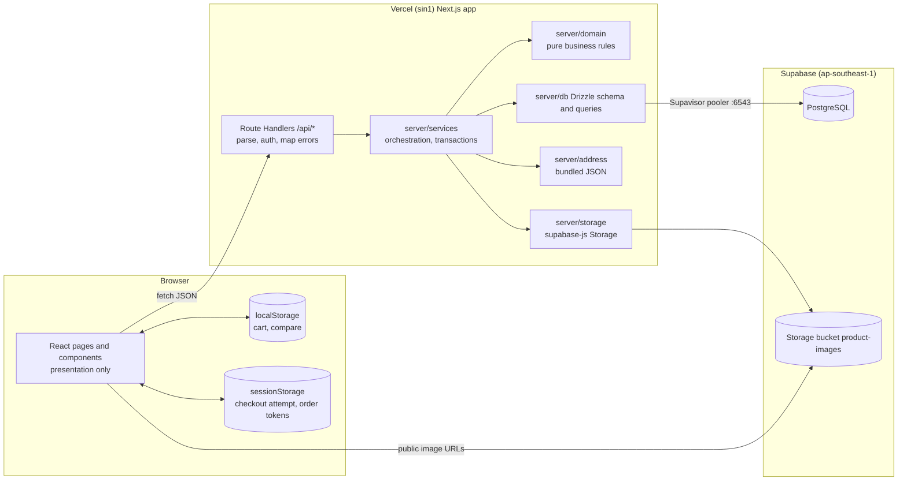
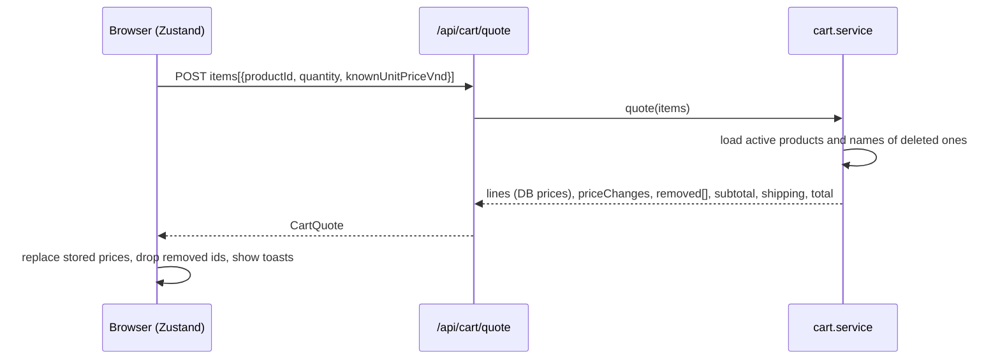
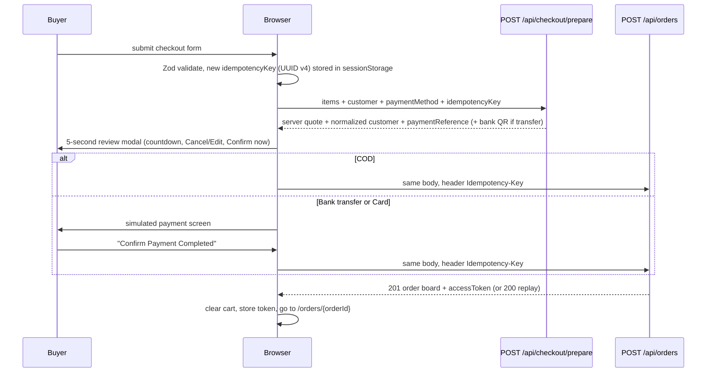
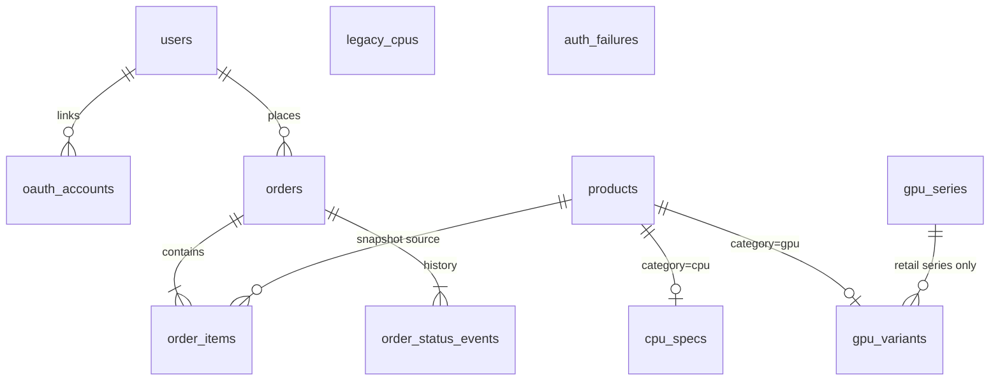

# Technical Solution: CPU and GPU E-Commerce Website

| Item | Value |
| --- | --- |
| Source specification | `idea.md` (Project "CoreRaster") |
| Document status | Draft for approval |
| Date | 2026-11-17 |
| Package versions verified against | npm registry, 2026-11-17 |
| Decided by the project owner | Next.js full-stack architecture; English document; address data is the "best free dataset" (the 2-level dataset was chosen on that basis, see §0.2) |

---

## 0. Summary

### 0.1 Solution in one paragraph

The solution is one **Next.js 16** application (App Router, TypeScript) deployed as one Vercel project. All business rules live in a server-only layer (`src/server/**`) and are exposed through versionless JSON **Route Handlers** under `/api/*`. The React UI is a presentation layer: it calls those APIs (through TanStack Query) and renders what they return. It never computes prices, shipping fees, scores, highlights or wattage. Persistent data lives in **Supabase PostgreSQL**, accessed through **Drizzle ORM** and the `postgres` driver via the Supavisor transaction pooler. Product images live in **Supabase Storage**. The guest cart and the comparison selection live in browser `localStorage` (Zustand `persist`). The store's own server re-validates and re-prices them on every cart, compare and checkout view.

### 0.2 Deviations from `idea.md` that need sign-off

| # | Spec text | Change | Reason |
| --- | --- | --- | --- |
| D1 | §2.4 Shipping Address: cascading **Province/City -> District -> Ward** | Two cascading dropdowns: **Province/City (34) -> Ward/Commune/Special zone (3,321)** plus the detailed address input | Vietnam abolished the district level and merged 63 provinces into 34 on 1 July 2025. The free, MIT-licensed, actively maintained dataset (`thanglequoc/vietnamese-provinces-database`, data generated 2026-09-20) is 2-level. A 3-level dataset would show addresses that no longer exist. The owner delegated the choice to "whichever has the better free dataset". |
| D2 | §4 `ADMIN_PASSWORD` environment variable | The variable keeps the name `ADMIN_PASSWORD`, but its **value is a scrypt hash** produced by `npm run admin:hash`, not the plaintext password | This satisfies "cryptographic hash storage/comparison" and keeps the plaintext out of every environment. See §8.10. |

Everything else in `idea.md` is implemented as written. Where the spec left a detail open, the call I made is marked **[Call]** in this document, and all of them are listed in §16.

---

## 1. Intent, Goals, Constraints

### 1.1 Intent

The project is a working, publicly reachable demo store for a university live presentation. It must feel like a real Vietnamese hardware retailer: Vietnamese UI, VND prices, Zalo support. The three hardware tools are its distinguishing feature: Product Specification Comparison, Performance-per-Price Ranking, and the PSU Wattage Estimator. Payments and delivery are simulated, but every flow must be complete, robust under live clicking, and resettable between demos.

### 1.2 Goals

1. Every flow in `idea.md` §2 to §5 works end to end on Vercel + Supabase free tiers.
2. All rules in `idea.md` §6 "Backend-Centric Business Logic" live only in `src/server/**`. Each rule is a pure, unit-tested function.
3. The demo is deterministic and recoverable. "Reset Sample Data" returns the system to a known baseline in one click, and no external API is called at runtime (address data is bundled).
4. The UI skeleton can be restyled without touching logic. Every interactive element carries a stable `data-testid`.

### 1.3 Non-goals

There are no real payment gateways, no real shipping, no compatibility checking, no inventory counts (stock is always "In Stock"), no multi-language runtime switching (the strings are centralized so they can be swapped later), and no analytics. User accounts focus strictly on Google/Facebook OAuth2, customer username/password sign-in, integrated Admin Mode sign-in, authenticated checkout, and viewing placed orders ("Đơn hàng của tôi") without profile editing or email-verification bloat.

### 1.4 Anti-goals (failure even if it "works")

1. An order is created twice by a double click, or an order is created for a deleted product.
2. A price, fee or total shown to the buyer comes from client-side arithmetic instead of the server.
3. The demo breaks because an external service (maps, address API, CDN image host) is down.
4. Customer-facing text contains an em-dash (`—`) or bullet points (`idea.md` §6).
5. The admin password or the Supabase secret key reaches the browser bundle or the git repository.

### 1.5 Constraints

| Constraint | Consequence |
| --- | --- |
| Vercel Hobby (serverless, ephemeral filesystem, 4.5 MB request body limit) | No local DB or files. Image uploads are capped at 4 MB. Rate-limit state is stored in Postgres. |
| Supabase Free (500 MB DB, 1 GB Storage, project **pauses after ~7 days of inactivity**, direct DB host is IPv6-only) | Use the Supavisor pooler. A daily Vercel Cron calls `/api/health` to keep the project warm. Check before every demo (§14.4). |
| Vietnamese UI with English hardware terms | All strings live in one message catalog (`src/shared/messages/vi.ts`). |
| Live demo by students | Simple stack, one repo, one deploy, typed end to end. |

---

## 2. Approaches Considered

### 2.1 Overall architecture (owner picked A)

| | A. Next.js full-stack, one project (**chosen**) | B. Vite React SPA + separate API (Hono on Vercel Functions) | C. Next.js + browser talks to Supabase directly (RLS + Postgres RPC) |
| --- | --- | --- | --- |
| Shape | UI pages + `/api/*` Route Handlers + `server/services` in one repo | Two apps (or a monorepo), two deploys | Thin server; most logic in SQL functions and RLS policies |
| Pros | One deploy, one domain (no CORS); FE and BE share types and Zod schemas; first-class on Vercel; easy to explain | Hard FE/BE separation that is visible to graders | Least server code |
| Cons | FE and BE in one codebase, so separation must be enforced by folders and the `server-only` import guard | Two deploy pipelines, CORS, duplicated or monorepo-shared types, more moving parts for a demo | IP-based rate limiting and a custom admin password do not fit RLS. Logic in PL/pgSQL is harder to test. Weakens the "backend-centric, testable" requirement. |
| Verdict | Best fit for scope and team size | Only worth it if the course required separate repos (it does not, per the owner) | Dropped |

### 2.2 Key sub-decisions

| Decision | Options | Choice and reason |
| --- | --- | --- |
| Data access | Drizzle ORM · Prisma · `supabase-js` (PostgREST) | **Drizzle + `postgres` driver.** SQL-first and typed, real transactions (needed for order creation), lightweight cold starts on serverless, and migrations are plain SQL files. Prisma's engine and connection handling are heavier on serverless. `supabase-js` has no multi-statement transactions. `supabase-js` is used **only for Storage**. |
| UI data fetching | Server Components calling services · Client Components calling `/api` | **Client Components + TanStack Query against `/api/*`.** This literally matches "frontend invokes backend APIs". The API becomes the single contract for UI, E2E and API tests, and the UI is replaceable. Cost: loading skeletons instead of server-rendered first paint, which is acceptable for a demo. Server Components are used only for static shells and footer pages. |
| Client state (cart, compare) | Zustand `persist` · React Context + hand-rolled storage · Redux | **Zustand 5 with `persist` (localStorage)**: tiny, has a built-in persist middleware with versioned migrations, and works outside React (toasts, sync). |
| Validation | Zod · Valibot · hand-written | **Zod 4**, one schema shared by the checkout form (React Hook Form) and the API (authoritative). |
| Rate-limit store | Postgres table · Upstash Redis · in-memory | **Postgres table.** No extra service or account. In-memory state is useless on serverless. Demo traffic is tiny. |
| Address data | Bundled JSON · DB table · external API | **Bundled JSON** (about 290 KB, MIT). Offline, versioned in git, and readable by the server validator without a DB round trip. Served to the UI by cacheable API routes. |
| Order board access after placing or looking up an order | Resend Order ID + phone on every call · signed short-lived access token | **Signed access token (JWT, 24 h)** returned by order creation and by a successful lookup. The phone number is never stored in the browser or put in URLs, refreshing the board does not burn rate-limit attempts, and the demo-control button is authorized by the same token. |
| Image upload | Server-proxied multipart · signed direct-upload URL | **Server-proxied, at most 4 MB** (inside Vercel's 4.5 MB body limit). It is simpler, and validation (MIME type, magic bytes, size) happens in one place. |
| Styling | Tailwind CSS 4 · CSS Modules · component kit | **Tailwind CSS 4** plus a small set of in-house primitives (`components/ui`). This keeps the "skeleton first, restyle later" rule: visual changes stay in class names and primitives. |

---

## 3. Tech Stack (pinned versions)

Pin exact versions in `package.json` and commit `package-lock.json`.

| Layer | Package | Version | Notes |
| --- | --- | --- | --- |
| Runtime | Node.js | **22.x LTS** (Vercel project setting) | Next 16 requires `>= 20.9` |
| Framework | `next` | **16.4.6** | App Router, Route Handlers, `runtime = 'nodejs'` everywhere |
| UI | `react`, `react-dom` | **19.3.1** | |
| Language | `typescript` | **6.0.3** | **[Call]** Not 7.0.x. TS 7 is the native rewrite, and Next's type-check step and `typescript-eslint` rely on the JS compiler API. Upgrade once both officially support 7.x. |
| Types | `@types/node` 22.x line, `@types/react` 19.3.0, `@types/qrcode` 1.5.6 | | Match `@types/node` to the Node 22 runtime |
| ORM | `drizzle-orm` | **0.45.4** | |
| Migrations | `drizzle-kit` | **0.31.11** | `generate` + `migrate`; custom SQL migrations for the view, triggers and RLS |
| DB driver | `postgres` (postgres.js) | **4.1.1** | `prepare: false` (required by the transaction pooler) |
| Storage SDK | `@supabase/supabase-js` | **2.119.0** | Server only, with the secret key |
| Validation | `zod` | **4.6.7** | Shared FE/BE schemas |
| Forms | `react-hook-form` 7.92.0, `@hookform/resolvers` 7.0.6 | | Resolver supports Zod 4 |
| Server state | `@tanstack/react-query` | **5.107.1** | |
| Client state | `zustand` | **5.1.0** | `persist` middleware |
| Styling | `tailwindcss` | **4.3.5** | With `@tailwindcss/postcss` |
| Auth tokens | `jose` | **6.2.17** | HS256 JWT for the admin session and order access tokens |
| Password hash | Node `crypto.scrypt` | built-in | No native dependency |
| QR image | `qrcode` | **1.5.4** | Server-side data URL |
| Client IP | `@vercel/functions` | **3.11.3** | `ipAddress(request)` |
| Server guard | `server-only` | **0.0.1** | Build fails if server code is imported by a client component |
| Unit tests | `vitest` + `@vitest/coverage-v8` | **5.1.0** | Domain functions (100% coverage via `test:coverage`), services, infra, and client stores |
| E2E tests | `@playwright/test` | **1.65.1** | Uses `data-testid` |
| Lint | `eslint` 10.15.0, `eslint-config-next` 16.4.6 | | |
| Database | Supabase PostgreSQL (managed, Postgres 15+ as provisioned) | | Region **ap-southeast-1 (Singapore)** |
| Hosting | Vercel (Hobby) | | Function region **`sin1`**, next to the DB |
| Address dataset | `thanglequoc/vietnamese-provinces-database`, file `json/vn_only_simplified_json_generated_data_vn_units_minified.json` | data generated 2026-09-20 (34 provinces, 3,321 wards) | MIT; vendored into `src/data/`, license copied into `LICENSES/` |

---

## 4. Architecture and Data Flow

### 4.1 Layers



**Layer rules (enforced by folder structure, `import 'server-only'`, and an ESLint `no-restricted-imports` rule):**

1. `src/server/domain/*` holds pure functions only: no I/O, no `Date.now()` unless injected, and 100% unit-test coverage. This is where shipping fees, the order-ID alphabet, phone normalization, score normalization, Performance-per-Price ranking, highlight selection, compare validation, PSU tiering and phone masking live.
2. `src/server/services/*` calls domain functions and repositories, owns transactions, and throws typed `AppError`s.
3. `src/app/api/**/route.ts` handlers stay thin: parse the input with Zod, check auth and rate limits, call one service, and serialize. Every handler sets `export const runtime = 'nodejs'` and `export const dynamic = 'force-dynamic'` (except the address routes).
4. `src/features/*` and `src/components/*` never import from `src/server`. They import only `src/shared` (types, Zod schemas, constants, messages) and `src/lib` (API client, formatters).

### 4.2 Key flows

**Catalog browse.** The page mounts, then `GET /api/products?category=gpu&...` returns cards and facets. Normalized scores are computed in SQL by a window function over the active products in that category (§6.3). Filters re-query the API. Facets are computed over the whole active category, not the filtered subset **[Call]**, so options do not vanish while the user clicks.

**Cart and compare sync.**



The sync runs when the cart page or the checkout page mounts, and again after every cart mutation on those pages. Meanwhile `/compare` fetches active candidates directly from `GET /api/products?category=cpu` and `category=gpu` (retaining `POST /api/products/resolve` as a server utility endpoint).

**Checkout and order creation.**



Cancel/Edit discards the idempotency key and returns to the form (the cart is untouched). Leaving the payment screen creates nothing. Every final-submit button is disabled with a spinner while its request is in flight. The idempotency key makes a duplicate request return the same order, even if the button guard is bypassed.

**Order lookup and status advance.** `POST /api/orders/lookup` first checks the rate limit (§8.9), then matches on `(order_id, phone)` and returns the board plus a fresh access token. `POST /api/orders/{id}/advance` with `{expectedStage}` runs one atomic `UPDATE ... WHERE status_stage = expectedStage AND status_stage < 4`.

**Admin.** The header "Admin Mode" toggle opens a login modal, which calls `POST /api/admin/login`. On success the server sets an HttpOnly session cookie, and `/admin/*` pages call `/api/admin/*`. Each admin handler calls `requireAdmin()`, and mutating handlers also check `Origin`.

---

## 5. Directory Tree

```text
pc-hardware-store/
├── .env.example                      # every variable from §14.2, no secrets
├── .gitignore                        # .env*, except .env.example
├── drizzle.config.ts
├── eslint.config.mjs                 # includes no-restricted-imports for src/server
├── next.config.ts
├── package.json
├── playwright.config.ts
├── postcss.config.mjs
├── tsconfig.json                     # path alias @/* -> src/*
├── vercel.json                       # regions ["sin1"], daily cron -> /api/health
├── vitest.config.ts
├── LICENSES/
│   └── vietnamese-provinces-database.MIT.txt
├── docs/
│   ├── idea.md
│   └── technical_solution.md
├── drizzle/                          # generated + custom SQL migrations (committed)
├── seed-images/                      # baseline product images (uploaded to bucket seed/)
├── scripts/
│   ├── hash-admin-password.ts        # npm run admin:hash -- "<password>"
│   ├── seed.ts                       # npm run db:seed (uses server/db/seed)
│   ├── sync-seed-catalog.ts          # npm run db:sync (non-destructive seed upsert)
│   ├── upload-seed-images.ts         # npm run storage:seed
│   └── vendor-address-data.ts        # refreshes src/data/vn-admin-units.json from upstream
├── public/
│   ├── logo.png                      # 1200x1200 OpenGraph brand artwork
│   └── icons/ (zalo.svg, facebook.svg, github.svg, music.svg, logo-mark.png, logo-mark-light.png, placeholder-product.svg)
├── tests/
│   ├── helpers/                      # test-db.ts: local Postgres schema reset + pool helper
│   ├── unit/                         # vitest (fileParallelism: false): domain/, infra/, services/, client/, root unit tests
│   └── e2e/                          # playwright: flows by data-testid
└── src/
    ├── app/
    │   ├── layout.tsx                # root metadata template/OpenGraph, header, footer, ZaloButton, Providers
    │   ├── not-found.tsx             # 404 Vietnamese page with store CTAs
    │   ├── error.tsx                 # client error boundary with retry/home actions
    │   ├── page.tsx                  # home: hero, category tiles, tool shortcuts
    │   ├── cpu/page.tsx              # listing wrapper + metadata (category=cpu)
    │   ├── gpu/page.tsx              # listing wrapper + metadata (category=gpu)
    │   ├── search/page.tsx           # full results for ?q= (noIndex metadata)
    │   ├── products/[id]/page.tsx    # detail
    │   ├── compare/page.tsx          # /compare?ids=a,b,c
    │   ├── tools/perf-per-price/page.tsx # /tools/perf-per-price?category=cpu&maxPriceVnd=...
    │   ├── tools/psu/page.tsx        # /tools/psu?cpu=...&gpu=...
    │   ├── cart/page.tsx
    │   ├── checkout/page.tsx
    │   ├── checkout/payment/page.tsx # simulated bank QR / card screen
    │   ├── orders/page.tsx           # authenticated "My Orders" list
    │   ├── orders/lookup/page.tsx
    │   ├── orders/[orderId]/page.tsx # status board
    │   ├── policies/warranty/page.tsx
    │   ├── policies/payment-shipping/page.tsx
    │   ├── policies/contact/page.tsx
    │   ├── policies/privacy/page.tsx # OAuth/order privacy & data-deletion policy
    │   ├── admin/
    │   │   ├── layout.tsx            # client guard via unified /api/auth/session + noIndex metadata
    │   │   ├── page.tsx              # dashboard + Reset Sample Data
    │   │   ├── products/page.tsx     # retail CPUs and AIB GPUs (with Limited Edition flag)
    │   │   ├── gpu-series/page.tsx   # retail and legacy base series
    │   │   ├── legacy-cpus/page.tsx
    │   │   └── orders/page.tsx
    │   └── api/                      # one route.ts per endpoint in §9
    │       ├── health/
    │       ├── auth/                 # session/ login/ register/ logout/ oauth/[provider]/ oauth/[provider]/callback/
    │       ├── products/  products/featured/  products/[id]/  products/resolve/
    │       ├── search/suggest/
    │       ├── compare/
    │       ├── perf-per-price/
    │       ├── psu/options/  psu/estimate/
    │       ├── cart/quote/
    │       ├── checkout/prepare/
    │       ├── orders/  orders/mine/  orders/lookup/  orders/[orderId]/  orders/[orderId]/advance/
    │       ├── address/provinces/  address/provinces/[code]/wards/
    │       └── admin/
    │           ├── session/  login/  logout/
    │           ├── products/  products/[id]/
    │           ├── gpu-series/  gpu-series/[id]/
    │           ├── legacy-cpus/  legacy-cpus/[id]/
    │           ├── images/
    │           ├── orders/  orders/[orderId]/
    │           └── reset/
    ├── features/                     # 3-layer UI: use*Controller.ts ({ state, actions }) + components/*View.tsx (*Client.tsx for searchParams)
    │   ├── home/                     # useHomeController.ts, components/HomeClient.tsx, HomeView.tsx
    │   ├── catalog/                  # useCatalogController.ts, useProductCardActions.ts, components/CatalogClient.tsx, CatalogView.tsx, ProductCard.tsx
    │   ├── search/                   # useSearchSuggest.ts, useSearchResultsController.ts, SearchBar.tsx, components/
    │   ├── product-detail/           # useProductDetailController.ts, components/ProductDetailClient.tsx, ProductDetailView.tsx
    │   ├── cart/                     # store.ts, useCartController.ts, components/CartClient.tsx, CartView.tsx
    │   ├── compare/                  # useComparePageController.ts, components/CompareClient.tsx, CompareTableView.tsx
    │   ├── checkout/                 # attempt-storage.ts, useCheckoutController.ts, usePaymentController.ts, components/*Client.tsx + *View.tsx
    │   ├── orders/                   # order-tokens.ts, useMyOrdersController.ts, useOrderLookupController.ts, useOrderBoardController.ts, components/*Client.tsx + *View.tsx
    │   ├── auth/                     # useAuthSession.ts, components/AuthModal.tsx
    │   ├── perf-per-price/           # usePerfPerPriceController.ts, components/PerfPerPriceClient.tsx, PerfPerPriceView.tsx
    │   ├── psu/                      # usePsuController.ts, components/PsuClient.tsx, PsuEstimatorView.tsx
    │   ├── layout/                   # AppShell.tsx, Header.tsx, Footer.tsx, ZaloButton.tsx
    │   └── admin/                    # admin-error.ts, useAdminSession.ts, useAdmin*Controller.ts, components/AdminShell.tsx + *View.tsx
    ├── components/ui/                # Button, Input, Select, SearchableSelect, Card, Feedback, Icons, Table, Modal (<dialog>), Toast, toast-store, ProductImage
    ├── lib/
    │   ├── api-client.ts             # typed fetch wrapper (apiFetch, apiUpload, ApiClientError)
    │   ├── format.ts                 # VND, numbers, dates (vi-VN, Asia/Ho_Chi_Minh)
    │   ├── metadata.ts               # buildPageMetadata helper for App Router pages
    │   ├── query-provider.tsx        # TanStack Query client provider
    │   ├── safe-storage.ts           # SyncStateStorage + Zod-validated persist storage with memory fallback
    │   └── search-filter.ts          # diacritic-tolerant multi-token client filter for SearchableSelect
    ├── shared/
    │   ├── constants.ts              # every numeric rule in §8 (single source)
    │   ├── schemas/                  # zod: checkout, cart, admin payloads, query params
    │   ├── types/                    # DTOs in §7
    │   ├── messages/vi.ts            # ALL customer-facing strings
    │   └── testids.ts                # TEST_IDS catalog for interactive data-testid attributes
    ├── data/
    │   └── vn-admin-units.json       # vendored dataset (34 provinces, 3,321 wards)
    └── server/                       # every file starts with import 'server-only'
        ├── db/
        │   ├── client.ts             # postgres() singleton + drizzle()
        │   ├── schema/               # auth.ts, products.ts, cpu.ts, gpu.ts, legacy.ts, orders.ts, security.ts
        │   ├── views.ts              # storefront_products_v (pgView, existing)
        │   └── seed/
        │       ├── data/             # retail-cpus.ts, gpu-series.ts, gpu-variants.ts, legacy-cpus.ts, legacy-gpus.ts
        │       └── seed-catalog.ts   # used by scripts/seed.ts AND reset.service.ts
        ├── domain/
        │   ├── phone.ts  name.ts  shipping.ts  order-id.ts  cart-rules.ts
        │   ├── scoring.ts  compare.ts  featured.ts  psu.ts  masking.ts  slug.ts
        ├── services/
        │   ├── auth.service.ts  catalog.service.ts  search.service.ts  compare.service.ts  perf-per-price.service.ts  psu.service.ts
        │   ├── cart.service.ts  checkout.service.ts  order.service.ts
        │   ├── admin-catalog.service.ts  admin-order.service.ts  image.service.ts  reset.service.ts
        ├── auth/
        │   ├── password.ts           # scrypt hash/verify, timingSafeEqual
        │   ├── session.ts            # unified JWT auth_session cookie, requireSession(), requireAdmin()
        │   ├── oauth.ts              # Google PKCE + Facebook appsecret_proof OAuth2 helpers
        │   ├── admin-session.ts      # thin compatibility facade over session.ts
        │   └── order-token.ts        # issue/verify order access JWT
        ├── security/
        │   ├── rate-limit.ts  client-ip.ts  origin-check.ts
        ├── address/
        │   └── address.repo.ts       # Map lookups over src/data JSON
        ├── storage/
        │   └── supabase-storage.ts
        ├── payments/
        │   └── demo-bank.ts          # payment reference, QR payload/image
        └── http/
            ├── errors.ts             # AppError, codes, HTTP status map
            ├── handler.ts            # withHandler(): zod parse, error -> JSON
            └── route-helpers.ts      # shared query/param/origin/auth helpers for Route Handlers
```

---

## 6. Data Model

### 6.1 Entity overview



1. **`products`** holds the sellable storefront items: retail CPUs and AIB GPU variants. It provides one ID space for the cart, comparison, Performance-per-Price ranking and orders.
2. **`cpu_specs`** (1:1) holds retail CPU specifications.
3. **`gpu_series`** holds base GPU series with `kind = 'retail' | 'legacy'`. Retail series carry the full specifications that AIB variants inherit. Legacy series (Appendix A.2) carry only what the PSU tool needs. `kind` is immutable.
4. **`gpu_variants`** (1:1 with `products`) holds AIB-specific attributes only (including `is_limited_edition` boolean). It can reference only a `retail` series, which is enforced by a composite foreign key.
5. **`legacy_cpus`** holds the Appendix A.1 reference CPUs. It is a separate table, so it can never become a product.
6. **`users`** & **`oauth_accounts`** store registered customer credentials (`scrypt` hash, username `'admin'` forbidden at DB CHECK level) and Google/Facebook OAuth links.
7. **`orders`**, **`order_items`** and **`order_status_events`** hold orders with immutable snapshots and nullable `user_id` linking to `users`.
8. **`auth_failures`** holds the failed lookup, login and registration attempts used for rate limiting.

**Strict separation, structurally enforced:** retail and legacy CPUs live in different tables. GPU variants can point only at `retail` series (composite FK on `(series_id, series_kind)` with `series_kind` fixed to `'retail'`). A trigger forbids changing `gpu_series.kind`. Name uniqueness across retail and legacy (the "non-overlapping datasets" rule) is enforced by partial unique indexes inside each table and by a service-level cross-table check between `products` (CPU) and `legacy_cpus` (§10, C21).

### 6.2 DDL (authoritative; mirror it in Drizzle schema files)

```sql
-- ===== Enums =====
CREATE TYPE category        AS ENUM ('cpu', 'gpu');
CREATE TYPE cpu_vendor      AS ENUM ('intel', 'amd');
CREATE TYPE gpu_vendor      AS ENUM ('nvidia', 'amd');
CREATE TYPE gpu_series_kind AS ENUM ('retail', 'legacy');
CREATE TYPE payment_method  AS ENUM ('cod', 'bank_transfer', 'card');
CREATE TYPE auth_scope      AS ENUM ('order_lookup', 'admin_login', 'user_login', 'user_register');
CREATE TYPE oauth_provider  AS ENUM ('google', 'facebook');

-- ===== Users & OAuth =====
CREATE TABLE users (
  id             uuid PRIMARY KEY DEFAULT gen_random_uuid(),
  username       text UNIQUE CHECK (username IS NULL OR (username ~ '^[a-z0-9_.-]{3,30}$' AND username <> 'admin')),
  password_hash  text,
  email          text,
  display_name   text NOT NULL CHECK (char_length(display_name) BETWEEN 1 AND 80),
  avatar_url     text,
  created_at     timestamptz NOT NULL DEFAULT now(),
  updated_at     timestamptz NOT NULL DEFAULT now(),
  CHECK ((username IS NULL AND password_hash IS NULL) OR (username IS NOT NULL AND password_hash IS NOT NULL))
);
CREATE INDEX users_email_idx ON users (email);

CREATE TABLE oauth_accounts (
  provider             oauth_provider NOT NULL,
  provider_account_id  text NOT NULL,
  user_id              uuid NOT NULL REFERENCES users (id) ON DELETE CASCADE,
  provider_email       text,
  created_at           timestamptz NOT NULL DEFAULT now(),
  PRIMARY KEY (provider, provider_account_id)
);
CREATE INDEX oauth_accounts_user_idx ON oauth_accounts (user_id);

-- ===== Catalog =====
CREATE TABLE products (
  id                  text PRIMARY KEY CHECK (id ~ '^[a-z0-9]+(-[a-z0-9]+)*$' AND char_length(id) <= 80),
  category            category    NOT NULL,
  name                text        NOT NULL CHECK (char_length(name) BETWEEN 2 AND 150),
  price_vnd           bigint      NOT NULL CHECK (price_vnd > 0),
  image_url           text,                       -- external https URL or Supabase public URL
  image_storage_path  text,                       -- set only when the file lives in our bucket
  is_seed             boolean     NOT NULL DEFAULT false,
  created_at          timestamptz NOT NULL DEFAULT now(),
  updated_at          timestamptz NOT NULL DEFAULT now(),
  deleted_at          timestamptz,                -- soft delete
  UNIQUE (id, category)                           -- target of the 1:1 composite FKs
);
CREATE UNIQUE INDEX products_active_name_uq ON products (lower(name)) WHERE deleted_at IS NULL;

CREATE TABLE cpu_specs (
  product_id            text PRIMARY KEY,
  category              category NOT NULL DEFAULT 'cpu' CHECK (category = 'cpu'),
  vendor                cpu_vendor NOT NULL,
  architecture          text NOT NULL,            -- "Zen 5", "Arrow Lake-S"
  socket                text NOT NULL,            -- "AM5", "LGA1851"
  process_node          text NOT NULL,            -- "TSMC 4nm"
  cores_total           smallint NOT NULL CHECK (cores_total > 0),
  threads_total         smallint NOT NULL CHECK (threads_total >= cores_total),
  p_cores               smallint CHECK (p_cores > 0),
  e_cores               smallint CHECK (e_cores >= 0),
  base_clock_ghz        numeric(4,2) NOT NULL CHECK (base_clock_ghz > 0),
  boost_clock_ghz       numeric(4,2) NOT NULL CHECK (boost_clock_ghz >= base_clock_ghz),
  cache_text            text NOT NULL,            -- "L1 1.25 MB, L2 16 MB, L3 32 MB" (no bullets)
  l3_cache_mb           numeric(6,1) NOT NULL CHECK (l3_cache_mb > 0),
  tdp_w                 smallint NOT NULL CHECK (tdp_w > 0),          -- base TDP, used by Compare
  psu_power_w           smallint NOT NULL CHECK (psu_power_w >= tdp_w), -- PL2/MTP or PPT, used by PSU tool
  ram_support           text NOT NULL,            -- "DDR5-5600"
  passmark_raw          integer NOT NULL CHECK (passmark_raw > 0),     -- PassMark CPU Mark
  passmark_source       text NOT NULL DEFAULT 'PassMark',
  CHECK ((p_cores IS NULL AND e_cores IS NULL) OR (p_cores + e_cores = cores_total)),
  FOREIGN KEY (product_id, category) REFERENCES products (id, category)
);

CREATE TABLE gpu_series (
  id                    text PRIMARY KEY CHECK (id ~ '^[A-Za-z0-9-]{2,60}$'), -- 'gs-rtx-5070', 'G01'
  kind                  gpu_series_kind NOT NULL,
  name                  text NOT NULL CHECK (char_length(name) BETWEEN 2 AND 100), -- "NVIDIA GeForce RTX 5070"
  vendor                gpu_vendor NOT NULL,
  vram_gb               smallint NOT NULL CHECK (vram_gb > 0),
  tbp_w                 smallint NOT NULL CHECK (tbp_w > 0),   -- TBP/TDP, used by Compare and PSU
  cores                 integer  CHECK (cores > 0),            -- CUDA cores / stream processors
  base_clock_mhz        integer  CHECK (base_clock_mhz > 0),
  boost_clock_mhz       integer  CHECK (boost_clock_mhz > 0),
  memory_type           text,                                  -- "GDDR7"
  bus_width_bit         smallint CHECK (bus_width_bit > 0),
  passmark_raw          integer  CHECK (passmark_raw > 0),     -- PassMark G3D Mark
  passmark_source       text,
  is_seed               boolean NOT NULL DEFAULT false,
  created_at            timestamptz NOT NULL DEFAULT now(),
  updated_at            timestamptz NOT NULL DEFAULT now(),
  deleted_at            timestamptz,
  UNIQUE (id, kind),
  CHECK (kind = 'legacy' OR (
    cores IS NOT NULL AND base_clock_mhz IS NOT NULL AND boost_clock_mhz IS NOT NULL
    AND memory_type IS NOT NULL AND bus_width_bit IS NOT NULL
    AND passmark_raw IS NOT NULL AND passmark_source IS NOT NULL
    AND boost_clock_mhz >= base_clock_mhz))
);
CREATE UNIQUE INDEX gpu_series_active_name_uq ON gpu_series (lower(name)) WHERE deleted_at IS NULL;

CREATE FUNCTION forbid_series_kind_change() RETURNS trigger LANGUAGE plpgsql AS $$
BEGIN
  IF NEW.kind IS DISTINCT FROM OLD.kind THEN
    RAISE EXCEPTION 'gpu_series.kind is immutable' USING ERRCODE = 'check_violation';
  END IF;
  RETURN NEW;
END $$;
CREATE TRIGGER gpu_series_kind_immutable BEFORE UPDATE ON gpu_series
  FOR EACH ROW EXECUTE FUNCTION forbid_series_kind_change();

CREATE TABLE gpu_variants (
  product_id      text PRIMARY KEY,
  category        category NOT NULL DEFAULT 'gpu' CHECK (category = 'gpu'),
  series_id       text NOT NULL,
  series_kind     gpu_series_kind NOT NULL DEFAULT 'retail' CHECK (series_kind = 'retail'),
  aib_brand           text NOT NULL CHECK (char_length(aib_brand) BETWEEN 2 AND 40), -- "ASUS"
  is_limited_edition  boolean NOT NULL DEFAULT false,
  length_mm           smallint NOT NULL CHECK (length_mm BETWEEN 100 AND 450),
  slot_thickness  numeric(3,1) NOT NULL CHECK (slot_thickness BETWEEN 1 AND 5),   -- PCIe slots
  hdmi_count      smallint NOT NULL CHECK (hdmi_count BETWEEN 0 AND 8),
  dp_count        smallint NOT NULL CHECK (dp_count BETWEEN 0 AND 8),
  FOREIGN KEY (product_id, category)  REFERENCES products (id, category),
  FOREIGN KEY (series_id, series_kind) REFERENCES gpu_series (id, kind)
);
CREATE INDEX gpu_variants_series_idx ON gpu_variants (series_id);

CREATE TABLE legacy_cpus (
  id             text PRIMARY KEY CHECK (id ~ '^C[0-9]{2,4}$'),   -- 'C01'..'C24', admin adds 'C25'..
  name           text NOT NULL CHECK (char_length(name) BETWEEN 2 AND 100),
  vendor         cpu_vendor NOT NULL,
  socket         text,
  cores_total    smallint CHECK (cores_total > 0),
  threads_total  smallint CHECK (threads_total > 0),
  psu_power_w    smallint NOT NULL CHECK (psu_power_w > 0),
  is_seed        boolean NOT NULL DEFAULT false,
  created_at     timestamptz NOT NULL DEFAULT now(),
  updated_at     timestamptz NOT NULL DEFAULT now(),
  deleted_at     timestamptz
);
CREATE UNIQUE INDEX legacy_cpus_active_name_uq ON legacy_cpus (lower(name)) WHERE deleted_at IS NULL;
-- Legacy GPU series use gpu_series(kind='legacy') with ids 'G01'..'G33', admin adds 'G34'..

-- ===== Orders =====
CREATE TABLE orders (
  id                 text PRIMARY KEY CHECK (id ~ '^PC-[A-HJKMNP-TV-Z0-9]{10}$'),
  user_id            uuid REFERENCES users (id) ON DELETE SET NULL,
  idempotency_key    uuid NOT NULL UNIQUE,
  request_hash       text NOT NULL,                 -- sha256 of canonical request, see §8.8
  customer_name      text NOT NULL,
  phone              text NOT NULL CHECK (phone ~ '^0(3|5|7|8|9)[0-9]{8}$'), -- normalized
  province_code      text NOT NULL,
  province_name      text NOT NULL,                 -- snapshot
  ward_code          text NOT NULL,
  ward_name          text NOT NULL,                 -- snapshot
  street_address     text NOT NULL,
  note               text,
  payment_method     payment_method NOT NULL,
  payment_reference  text NOT NULL,                 -- simulated transfer memo / receipt ref
  total_quantity     integer NOT NULL CHECK (total_quantity BETWEEN 1 AND 2000),
  subtotal_vnd       bigint  NOT NULL CHECK (subtotal_vnd > 0),
  shipping_fee_vnd   bigint  NOT NULL CHECK (shipping_fee_vnd IN (0, 50000)),
  total_vnd          bigint  NOT NULL CHECK (total_vnd = subtotal_vnd + shipping_fee_vnd),
  status_stage       smallint NOT NULL DEFAULT 0 CHECK (status_stage BETWEEN 0 AND 4),
  created_at         timestamptz NOT NULL DEFAULT now(),
  updated_at         timestamptz NOT NULL DEFAULT now()
);
CREATE INDEX orders_created_at_idx ON orders (created_at DESC);
CREATE INDEX orders_user_created_idx ON orders (user_id, created_at DESC);

CREATE TABLE order_items (
  order_id        text NOT NULL REFERENCES orders (id) ON DELETE CASCADE,
  line_no         smallint NOT NULL CHECK (line_no BETWEEN 1 AND 20),
  product_id      text NOT NULL REFERENCES products (id),    -- products are never hard-deleted
  product_name    text NOT NULL,                             -- snapshot
  category        category NOT NULL,                         -- snapshot
  unit_price_vnd  bigint NOT NULL CHECK (unit_price_vnd > 0),-- snapshot
  quantity        smallint NOT NULL CHECK (quantity BETWEEN 1 AND 100),
  line_total_vnd  bigint NOT NULL CHECK (line_total_vnd = unit_price_vnd * quantity),
  PRIMARY KEY (order_id, line_no),
  UNIQUE (order_id, product_id)
);

CREATE TABLE order_status_events (
  order_id     text NOT NULL REFERENCES orders (id) ON DELETE CASCADE,
  stage        smallint NOT NULL CHECK (stage BETWEEN 0 AND 4),
  occurred_at  timestamptz NOT NULL DEFAULT now(),
  PRIMARY KEY (order_id, stage)                              -- a stage is reached once, never twice
);

-- ===== Security =====
CREATE TABLE auth_failures (
  id           bigint GENERATED ALWAYS AS IDENTITY PRIMARY KEY,
  scope        auth_scope NOT NULL,
  ip_hash      text NOT NULL,                                -- HMAC-SHA256(AUTH_SECRET, ip), hex
  occurred_at  timestamptz NOT NULL DEFAULT now()
);
CREATE INDEX auth_failures_lookup_idx ON auth_failures (scope, ip_hash, occurred_at DESC);

-- ===== Lock down the Supabase Data API =====
-- The app connects as the postgres role through the pooler (bypasses RLS).
-- Enabling RLS with NO policies makes every table unreachable through PostgREST with anon/publishable keys.
ALTER TABLE users               ENABLE ROW LEVEL SECURITY;
ALTER TABLE oauth_accounts      ENABLE ROW LEVEL SECURITY;
ALTER TABLE products            ENABLE ROW LEVEL SECURITY;
ALTER TABLE cpu_specs           ENABLE ROW LEVEL SECURITY;
ALTER TABLE gpu_series          ENABLE ROW LEVEL SECURITY;
ALTER TABLE gpu_variants        ENABLE ROW LEVEL SECURITY;
ALTER TABLE legacy_cpus         ENABLE ROW LEVEL SECURITY;
ALTER TABLE orders              ENABLE ROW LEVEL SECURITY;
ALTER TABLE order_items         ENABLE ROW LEVEL SECURITY;
ALTER TABLE order_status_events ENABLE ROW LEVEL SECURITY;
ALTER TABLE auth_failures       ENABLE ROW LEVEL SECURITY;
```

`updated_at` is maintained by the services (set to `now()` on every update); a trigger is optional.

### 6.3 Storefront view (inheritance + dynamic normalization)

```sql
CREATE VIEW storefront_products_v AS
WITH rows AS (
  SELECT p.id, p.category, p.name, p.price_vnd, p.image_url, p.updated_at,
         c.vendor::text AS vendor, NULL::text AS aib_brand, NULL::text AS series_id,
         false AS is_limited_edition,
         c.socket, NULL::smallint AS vram_gb, c.passmark_raw
  FROM products p JOIN cpu_specs c ON c.product_id = p.id
  WHERE p.deleted_at IS NULL
  UNION ALL
  SELECT p.id, p.category, p.name, p.price_vnd, p.image_url, p.updated_at,
         s.vendor::text, v.aib_brand, s.id,
         v.is_limited_edition,
         NULL::text, s.vram_gb, s.passmark_raw              -- inherited from base series
  FROM products p
  JOIN gpu_variants v ON v.product_id = p.id
  JOIN gpu_series  s ON s.id = v.series_id
  WHERE p.deleted_at IS NULL AND s.deleted_at IS NULL
)
SELECT r.*,
       round(100.0 * r.passmark_raw / max(r.passmark_raw) OVER (PARTITION BY r.category), 1)
         AS normalized_score,
       lower(concat_ws(' ', r.name, r.vendor, r.aib_brand, r.socket, r.series_id)) AS search_text
FROM rows r;
```

Filters applied to this view (`WHERE vram_gb = 16`) are evaluated **after** the window function, because Postgres does not push predicates on non-partition columns below a window. Normalization therefore always uses the maximum over **all** active products in the category, as the spec requires. Service queries that need full specs join `cpu_specs` or `gpu_series` by `id` / `series_id`. The view is created in a custom drizzle-kit SQL migration and declared in Drizzle with `pgView(...).existing()`.

### 6.4 Storage layout (bucket `product-images`, public read)

| Prefix | Content | Written by | Removed by Reset |
| --- | --- | --- | --- |
| `seed/` | Baseline images referenced by seed rows | `npm run storage:seed` | Never |
| `uploads/{uuid}.{jpg\|png\|webp}` | Admin uploads | `POST /api/admin/images` | **Always** (purged in full) |

When a product's uploaded image is replaced, the old `uploads/` object is deleted on a best-effort basis **[Call]**. Abandoned uploads (the admin uploaded a file but never saved the form) are cleared by the next Reset.

### 6.5 Browser storage schema

```ts
// localStorage key "pcstore.cart.v1"  (Zustand persist, version 1)
interface CartState {
  items: { productId: string; quantity: number; lastKnownUnitPriceVnd: number | null; addedAt: string }[];
}
// localStorage key "pcstore.compare.v1"
interface CompareState {
  category: 'cpu' | 'gpu' | null;   // set by the first item, cleared when empty
  productIds: string[];             // max 3, unique
}
// sessionStorage
// "pcstore.checkout.attempt" -> { idempotencyKey: string; request: CheckoutRequest; prepared: PrepareResponse }
// "pcstore.order.<orderId>.token" -> access token string (24 h JWT)
```

On load, each store parses its stored value with a Zod schema. Invalid or legacy data resets that store to empty **[Call]**. `safe-storage.ts` falls back to in-memory storage when `localStorage` throws (private mode, quota). The cart badge renders only after hydration, to avoid an SSR mismatch.

---

## 7. Core Types and Interfaces (`src/shared/types`)

```ts
export type Category = 'cpu' | 'gpu';
export type ChipVendor = 'intel' | 'amd' | 'nvidia';
export type PaymentMethod = 'cod' | 'bank_transfer' | 'card';
export type OrderStage = 0 | 1 | 2 | 3 | 4; // Placed, Preparing, In Transit, Out for Delivery, Delivered

export interface SpecItem { key: string; label: string; value: string }          // label in Vietnamese
export interface SpecGroup { key: string; title: string; items: SpecItem[] }

export interface Score { raw: number; normalized: number | null; source: string }

export type UserRole = 'customer' | 'admin';
export type OAuthProvider = 'google' | 'facebook';
export type AuthProvider = 'password' | OAuthProvider | 'admin';

export interface SessionUser {
  id: string;
  role: UserRole;
  username: string | null;
  displayName: string;
  avatarUrl: string | null;
  provider: AuthProvider;
}
export interface AuthSessionResponse {
  user: SessionUser | null;
  providers: Record<OAuthProvider, boolean>;
}

export interface ProductCard {
  id: string;
  category: Category;
  name: string;
  priceVnd: number;
  imageUrl: string | null;
  vendor: ChipVendor;
  aibBrand: string | null;              // GPU only
  isLimitedEdition: boolean;            // GPU limited/collab flag
  score: Pick<Score, 'raw' | 'normalized'>;
  summary: SpecItem[];                  // CPU: cores/threads, boost, socket, TDP. GPU: VRAM, memory type, boost, TBP
}

export interface ProductListQuery {
  category: Category;
  vendor?: ChipVendor[];
  priceMin?: number; priceMax?: number;
  vramGb?: number[];                    // GPU only
  aibBrand?: string[];                  // GPU only
  socket?: string[];                    // CPU only
  limitedEdition?: boolean;             // GPU only
  sort?: 'default' | 'price_asc' | 'price_desc' | 'score_desc';
  q?: string;
}
export interface Facets {
  vendors: ChipVendor[];
  priceRange: { min: number; max: number } | null;
  vramGb?: number[];                    // ascending, only values present on active products
  aibBrands?: string[];                 // alphabetical
  sockets?: string[];
}
export interface ProductListResponse { items: ProductCard[]; facets: Facets; total: number }

export interface ProductDetail extends ProductCard {
  stockStatus: 'in_stock';              // always
  warrantyMonths: 36;                   // always
  packaging: 'full_box';                // always
  score: Score;
  specGroups: SpecGroup[];              // GPU adds "physical" (length, slots) and "outputs" (HDMI, DP)
  series: { id: string; name: string } | null; // GPU base series
  psuPrefill: { cpu?: string; gpu?: string };  // CPU: "store:<id>", GPU: "<seriesId>"
}

export interface SearchSuggestion { id: string; name: string; category: Category; priceVnd: number; imageUrl: string | null }
export interface FeaturedProductsResponse { cpus: ProductCard[]; gpus: ProductCard[] }

export interface ResolveResponse { active: Pick<ProductCard, 'id' | 'name' | 'category' | 'priceVnd' | 'imageUrl'>[]; removed: RemovedItem[] }
export interface RemovedItem { productId: string; name: string | null } // null when the id never existed

// ---- Cart / checkout ----
export interface CartItemInput { productId: string; quantity: number; knownUnitPriceVnd?: number | null }
export interface CartLine {
  productId: string; name: string; category: Category; imageUrl: string | null;
  unitPriceVnd: number; quantity: number; lineTotalVnd: number;
  priceChange: { fromVnd: number; toVnd: number } | null;
}
export interface CartQuote {
  lines: CartLine[];
  removed: RemovedItem[];
  totalQuantity: number;
  subtotalVnd: number;
  shippingFeeVnd: 0 | 50000;
  freeShipping: boolean;
  totalVnd: number;
}

export interface CustomerInput {
  fullName: string; phone: string;
  provinceCode: string; wardCode: string;
  streetAddress: string; note?: string;
}
export interface CheckoutRequest {
  idempotencyKey: string;               // UUID v4, also sent as Idempotency-Key header to /api/orders
  items: { productId: string; quantity: number }[];
  customer: CustomerInput;
  paymentMethod: PaymentMethod;
}
export interface NormalizedCustomer {
  fullName: string; phone: string; phoneMasked: string;
  provinceName: string; wardName: string; streetAddress: string; note: string | null;
  addressLine: string;                  // "12 Nguyễn Huệ, Phường Sài Gòn, Thành phố Hồ Chí Minh"
}
export interface BankInstructions {
  bankName: string; accountNumber: string; accountHolder: string;
  amountVnd: number; transferMemo: string; qrImageDataUrl: string;
}
export interface PrepareResponse {
  quote: CartQuote;                     // removed[] is always empty here (otherwise 409)
  customer: NormalizedCustomer;
  paymentMethod: PaymentMethod;
  paymentReference: string;             // "TT" + 8 chars, stable per idempotencyKey
  bankInstructions: BankInstructions | null; // only for bank_transfer
}

// ---- Orders ----
export interface OrderItemView { productName: string; category: Category; unitPriceVnd: number; quantity: number; lineTotalVnd: number }
export interface OrderBoard {
  orderId: string;
  stage: OrderStage;
  stages: { stage: OrderStage; label: string; reachedAt: string | null }[];
  isCompleted: boolean;                 // stage === 4
  customer: { fullName: string; phoneMasked: string; addressLine: string; note: string | null };
  paymentMethod: PaymentMethod;
  paymentReference: string;
  items: OrderItemView[];
  totalQuantity: number; subtotalVnd: number; shippingFeeVnd: number; totalVnd: number;
  createdAt: string;
}
export interface OrderWithToken { order: OrderBoard; accessToken: string; replayed?: boolean }
export interface CustomerOrderSummary {
  orderId: string; customerName: string; totalQuantity: number; totalVnd: number;
  stage: OrderStage; stageLabel: string; paymentMethod: PaymentMethod; createdAt: string;
}

// ---- Compare ----
export type HighlightRule = 'higher' | 'lower' | 'none';
export interface CompareRow {
  key: string; label: string; unit: string | null; rule: HighlightRule;
  cells: { display: string; highlighted: boolean }[]; // same order as products[]
}
export interface CompareResponse {
  category: Category;
  products: { id: string; name: string; priceVnd: number; imageUrl: string | null }[];
  rows: CompareRow[];
  notes: string[];                      // PassMark disclaimer, estimation disclaimer
}
export type CompareInvalidReason = 'NO_IDS' | 'TOO_MANY' | 'NOT_FOUND' | 'MIXED_CATEGORY' | 'TOO_FEW';

// ---- Performance-per-Price ----
export interface PerfPerPriceQuery {
  category: Category;
  vendor?: ChipVendor[];
  maxPriceVnd?: number;
}
export interface PerfPerPriceItem {
  rank: number;
  id: string;
  name: string;
  vendor: ChipVendor;
  aibBrand: string | null;
  priceVnd: number;
  score: Pick<Score, 'raw' | 'normalized'>;
  perfPerPrice: number;
  bestValue: boolean;
}
export interface PerfPerPriceResponse {
  category: Category;
  maxPriceVnd: number | null;
  items: PerfPerPriceItem[];
  notes: string[];                      // PassMark disclaimer, estimation disclaimer
}

// ---- PSU ----
export interface PsuOption { id: string; name: string; vendor: ChipVendor; source: 'store' | 'legacy' }
export interface PsuOptions { cpus: PsuOption[]; gpus: PsuOption[] }
export interface PsuEstimate {
  cpu: { id: string; name: string; psuPowerW: number };
  gpu: { id: string; name: string; tbpW: number };
  baseSystemW: 100;
  headroomFactor: 1.25;
  exactW: number;                       // e.g. 581.25
  recommendedTierW: 450 | 550 | 650 | 750 | 850 | 1000 | 1200 | null; // null when above 1200
  exceedsMaxTier: boolean;
  notes: string[];
}

// ---- Errors (every non-2xx response) ----
export interface ApiError { error: { code: ErrorCode; message: string; details?: Record<string, unknown> } }
export type ErrorCode =
  | 'VALIDATION_ERROR' | 'EMPTY_CART' | 'CART_LIMIT_EXCEEDED' | 'PRODUCT_UNAVAILABLE'
  | 'COMPARE_INVALID' | 'NOT_FOUND' | 'ORDER_NOT_FOUND' | 'RATE_LIMITED'
  | 'UNAUTHORIZED' | 'FORBIDDEN_ORIGIN' | 'IDEMPOTENCY_KEY_REUSED'
  | 'STALE_STAGE' | 'ORDER_COMPLETED' | 'HAS_VARIANTS' | 'DUPLICATE_NAME' | 'USERNAME_TAKEN'
  | 'SERIES_NOT_RETAIL' | 'IMAGE_INVALID' | 'INTERNAL';
```

Admin payload types (`AdminCpuInput`, `AdminGpuVariantInput`, `AdminGpuSeriesInput`, `AdminLegacyCpuInput`) are the Zod-inferred types of the schemas in §9.4.

---

## 8. Business Rules (domain layer, `src/server/domain`)

All constants live in `src/shared/constants.ts`. The footer page "Payment and Shipping Guide" renders its fee sentences from the same constants, so it can never drift from §8.3.

### 8.1 Phone normalization and validation (`phone.ts`)

1. Remove spaces, `.` and `-` (only these characters).
2. If the result starts with `+84`, replace that prefix with `0`. Otherwise, if the result starts with `84`, replace that prefix with `0`.
3. The result must match `^0(3|5|7|8|9)\d{8}$`, otherwise it is a validation error.
4. Masking (`masking.ts`): the first 4 digits, `***`, then the last 3 digits (`0912345789` becomes `0912***789`).

### 8.2 Text fields (`name.ts`)

All text fields are Unicode NFC-normalized, trimmed, and have internal whitespace runs collapsed to one space **[Call]**, before length checks.

| Field | Rule |
| --- | --- |
| Full name | 2 to 50 characters. Any printable characters, Vietnamese diacritics allowed. Control characters are rejected. |
| Province | Must be a code in the dataset |
| Ward | Must be a code in the dataset **whose `ProvinceCode` equals the chosen province** |
| Street address | 10 to 200 characters, required |
| Note | Optional, at most 300 characters; empty becomes `null` |

### 8.3 Cart rules and shipping (`cart-rules.ts`, `shipping.ts`)

1. Items: 1 to 20 distinct `productId`s. Each quantity is an integer from 1 to 100. Duplicated IDs in one request cause a `VALIDATION_ERROR` (the UI never sends them).
2. An empty item list returns `400 EMPTY_CART`.
3. `totalQuantity = sum(quantity)`. `shippingFee = totalQuantity >= 2 ? 0 : 50000`. `total = subtotal + shippingFee`.
4. All money is an integer number of VND (`bigint` in the DB, JS `number` in the API; safe far beyond any possible cart value).

### 8.4 Order ID (`order-id.ts`)

1. Alphabet `ABCDEFGHJKMNPQRSTVWXYZ0123456789` (22 letters + 10 digits = 32 symbols; `I`, `L`, `O`, `U` excluded).
2. Draw 10 bytes from `crypto.randomBytes(10)` and map each byte with `byte & 31`. Because 32 divides 256, there is no modulo bias.
3. The ID is `PC-` plus those 10 characters, which gives 50 bits of randomness.
4. Uniqueness: the `INSERT` relies on the primary key. On error `23505` for `orders_pkey`, regenerate and retry the whole transaction, at most 5 attempts, then `500`.

### 8.5 Score normalization and Performance-per-Price (`scoring.ts`)

1. `normalized = round1(raw / maxRawInCategory * 100)`, where the maximum is taken over active storefront products in the same category. It is computed in SQL (§6.3), and `scoring.ts` holds the identical function for tests and for the compare and ranking services.
2. `perfPerPrice = round2(normalized / (priceVnd / 1_000_000))`, using the **displayed** (1-decimal) normalized score, so a reader can reproduce it by hand **[Call]**.
3. `rankByPerfPerPrice(items, maxPriceVnd?)` filters active storefront items in the chosen category to `priceVnd <= maxPriceVnd` (when provided), computes `perfPerPrice` for each item, sorts by `perfPerPrice` descending, then `priceVnd` ascending, then `passmarkRaw` descending, assigns 1-based `rank`, and sets `bestValue = true` on every item whose `perfPerPrice` equals the top item's `perfPerPrice` (ties share the badge) **[Call]**.
4. GPU raw scores are PassMark **G3D Mark**. CPU raw scores are PassMark **CPU Mark**. The UI note says so.

### 8.6 Compare (`compare.ts`)

**Validation of `ids` (applied in this order):**

| Step | Check | Result if it fails |
| --- | --- | --- |
| 1 | Split on `,`, trim, drop empties, **dedupe** (first occurrence order kept). Reject anything that does not match the product ID regex. | Empty list: `NO_IDS` |
| 2 | More than 3 unique IDs | `TOO_MANY` |
| 3 | Every ID exists and is not soft-deleted | `NOT_FOUND` with `invalidIds` |
| 4 | All products are in the same category | `MIXED_CATEGORY` |
| 5 | At least 2 products | `TOO_FEW` |

All failures return `422 COMPARE_INVALID` with `details.reason`. The page shows an error card with a "Back to the store" button (`data-testid="compare-error-back"`).

**Rows (order exactly as `idea.md` §3.1 tables):**

| CPU row key | Value shown | Rule |
| --- | --- | --- |
| `price` | VND | lower |
| `score` | `normalized (raw)` e.g. `87,3 (45.210)` | higher |
| `architecture`, `socket`, `processNode` | text | none |
| `coresThreads` | `8 nhân / 16 luồng`, plus `(6 P-Core, 2 E-Core)` when hybrid | higher: compare `cores_total`, then `threads_total` |
| `baseClock`, `boostClock` | GHz, 2 decimals | none |
| `cache` | `cache_text` | none |
| `tdp` | W (base TDP) | none |
| `ramSupport` | text | none |

| GPU row key | Value shown | Rule |
| --- | --- | --- |
| `price`, `score` | as above | lower / higher |
| `vram` | GB | higher |
| `cores` | count, label "CUDA Cores" (NVIDIA) or "Stream Processors" (AMD) | higher |
| `tdp` | W (TBP) | none |
| `baseClock`, `boostClock` | MHz | none |
| `memoryType` | text | none |
| `busWidth` | bit | higher |

**Highlight selection:** compare on the displayed (rounded) values for highlightable criteria only (**CPU:** `price`, `score`, `coresThreads`; **GPU:** `price`, `score`, `vram`, `cores`, `busWidth`). Clock speeds, TDP/TBP, CPU L3 cache, and text rows always use `rule: 'none'` (`highlighted: false`). Every cell equal to the best value is highlighted. If **all** compared products tie on a row, no cell in that row is highlighted, because nothing stands out **[Call]**. The response contains no commentary text, only values, highlights and the two fixed disclaimer notes.

### 8.7 PSU estimator (`psu.ts`)

1. `exactW = (cpuPsuPowerW + gpuTbpW + 100) * 1.25`, an exact multiple of 0.25. It is displayed with up to 2 decimals in the vi-VN format (`581,25 W`).
2. `tiers = [450, 550, 650, 750, 850, 1000, 1200]`. If `exactW <= 450`, the tier is 450. If `exactW > 1200`, there is no tier: `exceedsMaxTier = true` and the note "Cần nguồn có công suất cao hơn các mức phổ biến trên thị trường." Otherwise the tier is the smallest one with `tier >= exactW`.
3. CPU options = active storefront CPUs (`store:<productId>`, using `psu_power_w`) plus active legacy CPUs (`legacy:<id>`). GPU options = active **retail series that have at least 1 active AIB variant** **[Call]** plus active legacy series (option ID = series ID, using `tbp_w`). Options are grouped in the UI as "Đang bán" and "Tham khảo (đời cũ)" and sorted by vendor, then name.
4. A product page prefills one side: `/tools/psu?cpu=store:<id>` or `/tools/psu?gpu=<seriesId>` (AIB variants map to their base series). If a prefilled option no longer exists, the selector stays empty and a notice is shown.
5. The tool never names or links a PSU product.

### 8.8 Idempotent order creation (`order.service.ts`)

1. `request_hash = sha256(canonicalJSON({items sorted by productId, normalized customer, paymentMethod}))`.
2. Inside one transaction:
   1. If an order with this `idempotency_key` exists: when the hashes are equal, return it (`200`, `replayed: true`, new access token). Otherwise return `409 IDEMPOTENCY_KEY_REUSED`.
   2. Re-run the full validation from `checkout/prepare`: field rules, address codes, cart rules, and product availability (any unavailable product returns `409 PRODUCT_UNAVAILABLE` with `details.items: [{productId, name}]`).
   3. Price every line from the DB, compute the totals (§8.3), and generate the order ID (§8.4).
   4. Insert with `INSERT ... ON CONFLICT (idempotency_key) DO NOTHING RETURNING id`. If no row comes back, a concurrent duplicate won the race: select that order and go back to step 2.1.
   5. Insert `order_items` (snapshots) and `order_status_events(stage 0)`.
3. Return `201` with the `OrderBoard` and an access token.

Client-sent prices are never read. The idempotency key is created when the review modal opens, kept through the payment screen and its retries, and discarded on Cancel/Edit or after success.

### 8.9 Rate limiting (`security/rate-limit.ts`)

| Scope | Limit | Counted event |
| --- | --- | --- |
| `order_lookup` | 5 failures / 15 min / IP | Any lookup that does not return an order, including malformed input |
| `admin_login` | 5 failures / 15 min / IP | Wrong admin password (`username === 'admin'`) |
| `user_login` | 5 failures / 15 min / IP | Invalid customer username or password |
| `user_register` | 5 failures / 15 min / IP | Duplicate username registration attempts |

1. `ip = ipAddress(request)` from `@vercel/functions`. Fallback: the first `x-forwarded-for` entry, then `'unknown'`. The stored value is `ip_hash = HMAC-SHA256(AUTH_SECRET, ip)`.
2. **Pre-check before verifying anything:** if there are at least 5 failure rows for `(scope, ip_hash)` with `occurred_at > now() - 15 min`, return `429 RATE_LIMITED` with `Retry-After = ceil(oldestInWindow + 15 min - now)` seconds and the message "Bạn đã thử quá nhiều lần. Vui lòng thử lại sau {n} phút." This is a sliding window. A successful attempt does not erase earlier failures **[Call]**.
3. On failure, insert one row. Opportunistically delete rows older than 24 h (in the same request, at most once per call).
4. Parallel requests can overshoot the limit by a few attempts. That is acceptable at demo scale and is noted for the builder.

### 8.10 Unified authentication, OAuth2 & Admin Mode (`auth/password.ts`, `auth/session.ts`, `auth/oauth.ts`)

1. The `ADMIN_PASSWORD` value has the format `scrypt:<N>:<r>:<p>:<saltB64url>:<hashB64url>`, produced by `npm run admin:hash -- "<password>"` with `N = 2^15`, `r = 8`, `p = 1`, a 16-byte salt and a 32-byte key. Customer passwords use the same `hashPassword` / `verifyPassword` helper (`:` separator because `@next/env` expands `$` in `.env` files).
2. Login recomputes scrypt with the stored parameters (pass `maxmem: 64 * 1024 * 1024`) and compares with `crypto.timingSafeEqual`. Entering `username === 'admin'` authenticates against `ADMIN_PASSWORD` and issues a `role: 'admin'` session (8 h TTL). Any other `username` authenticates against `users` (`role: 'customer'`, 7 d TTL). Customer registration reserves and blocks `'admin'`, `'root'`, `'system'`, `'coreraster'` both in Zod and at DB `CHECK`.
3. **OAuth2 (Google & Facebook):** Self-implemented without Supabase Auth or `next-auth`. `GET /api/auth/oauth/[provider]` signs a 10-minute HS256 `oauth_tx` cookie (`state`, Google `codeVerifier` PKCE S256, and open-redirect-sanitized `next` path). `GET /api/auth/oauth/[provider]/callback` exchanges the code server-side (`fetch` with 10 s timeout, Google `openid email profile`, Facebook `public_profile` + `appsecret_proof` HMAC-SHA256) and upserts `users` + `oauth_accounts` (only Google verified emails can link by email; Facebook accounts stay isolated per `(provider, provider_account_id)`).
4. **Unified session cookie:** Cookie `auth_session` = HS256 JWT `{sub: userId | 'admin', role, username, displayName, avatarUrl, provider, aud:'techcore-session'}` signed with `AUTH_SECRET`. Cookie attributes: `HttpOnly; SameSite=Lax; Path=/; Secure` (Secure in production; `SameSite=Lax` allows OAuth redirect callbacks while all mutations enforce `assertSameOrigin`).
5. `requireAdmin()` verifies `role === 'admin'`; `requireSession()` verifies any logged-in session (required for `/api/checkout/prepare`, `POST /api/orders`, and `GET /api/orders/mine`). `requireOrderViewer()` accepts `role === 'admin'`, a customer session owning `orders.user_id === session.id`, or a valid 24 h `Bearer <orderToken>`.

### 8.11 Simulated payments (`payments/demo-bank.ts`)

1. `paymentReference = "TT" + first 8 symbols (order-ID alphabet) of HMAC-SHA256(AUTH_SECRET, idempotencyKey)`. It is stable across re-prepares of the same attempt and stored on the order.
2. Bank transfer screen: bank name, account number and holder come from env (fake values). The amount is the server total, and the memo is `"<STORE_NAME> <paymentReference>"`. The QR is a PNG data URL generated server-side from a **plain-text payload that starts with `DEMO`**, deliberately **not** the EMVCo/VietQR format, so scanning it with a banking app can never start a real transfer **[Call]**.
3. Card screen: inputs accept any string. Card data stays in component state and **is never sent to the server or stored**.
4. COD: no payment screen. The order is created when the review modal confirms.

### 8.12 Homepage featured selection (`featured.ts`)

1. `pickFeaturedCandidates(candidates, limit = 8)` selects up to 8 CPUs and 8 GPUs deterministically from active storefront items without needing a curated database flag.
2. Within each category, candidates are grouped by `vendor`, deduplicated by `seriesId ?? id` first (rotating variant index per GPU series to vary AIB partners), allocated equal round-robin vendor quotas up to `limit` (yielding 4 Intel + 4 AMD CPUs, and 4 AMD + 4 NVIDIA distinct GPU series on seeded data), sampled across evenly spaced performance/price quantiles per vendor, and filled from overflow AIB variants only when fewer than `limit` distinct series exist.

---

## 9. API Contracts

Conventions: JSON over HTTPS. Success returns the documented body, errors return `ApiError` (§7). Every user-facing `message` is Vietnamese. Catalog and order responses send `Cache-Control: no-store`. Address responses send `Cache-Control: public, max-age=31536000, immutable` with `?v=<datasetDate>` in the URL. All handlers run on the Node.js runtime.

### 9.1 Public catalog and tools

| Method and path | Input | Output | Errors |
| --- | --- | --- | --- |
| `GET /api/health` | none | `{ ok: true, db: 'up' }` (runs `select 1`) | 503 |
| `GET /api/products` | Query: `ProductListQuery` (arrays as comma lists, e.g. `vramGb=8,16`; `limitedEdition=true` for GPU) | `ProductListResponse` | 400 `VALIDATION_ERROR` (e.g. `priceMin > priceMax`, GPU-only filter on CPU) |
| `GET /api/products/featured` | none | `FeaturedProductsResponse` (`8` balanced CPUs + `8` balanced GPUs) | none |
| `GET /api/products/{id}` | none | `ProductDetail` | 404 `NOT_FOUND` (missing or soft-deleted) |
| `POST /api/products/resolve` | `{ ids: string[] }` (max 20) | `ResolveResponse` | 400 |
| `GET /api/search/suggest?q=` | `q` 2 to 50 characters after trim (`%`, `_` escaped) | `SearchSuggestion[]` (max 8; name-prefix matches first, then by score) | 400 |
| `GET /api/compare?ids=a,b,c` | `ids` | `CompareResponse` | 422 `COMPARE_INVALID` + `details.reason` |
| `GET /api/perf-per-price` | Query: `category` (required), `vendor?` (comma list), `maxPriceVnd?` (positive int) | `PerfPerPriceResponse` (empty `items[]` if none match budget) | 400 `VALIDATION_ERROR` (missing/invalid category, non-positive `maxPriceVnd`, or invalid vendor for category) |
| `GET /api/psu/options` | none | `PsuOptions` | none |
| `GET /api/psu/estimate?cpu=&gpu=` | option IDs | `PsuEstimate` | 400 (missing), 404 (unknown/inactive option) |
| `GET /api/address/provinces` | none | `{ code, name }[]` (sorted with Vietnamese collation) | none |
| `GET /api/address/provinces/{code}/wards` | none | `{ code, name }[]` | 404 |

Default sort (`sort=default`): vendor, then normalized score descending. The UI groups cards into vendor sections only in default sort, and shows a flat list for any explicit sort **[Call]**. Full-text search (`/search?q=`) queries `GET /api/products?category=cpu&q=...` and `GET /api/products?category=gpu&q=...` in parallel, keeping `category` required on `GET /api/products` **[Call]**. There is no pagination: the catalog is under 200 rows, and the API caps results at 200.

### 9.2 Auth, cart, checkout, orders

| Method and path | Input | Output | Errors |
| --- | --- | --- | --- |
| `GET /api/auth/session` | none | `AuthSessionResponse` (`{ user, providers }`) | never 401 |
| `POST /api/auth/login` | `{ username, password }` + same-origin | 200 `{ user }` + sets `auth_session` cookie (`admin` if `username === 'admin'`) | 401 `UNAUTHORIZED`, 429 `RATE_LIMITED` |
| `POST /api/auth/register` | `{ username, displayName, password }` + same-origin | 201 `{ user }` + sets `auth_session` cookie | 400 `VALIDATION_ERROR`, 409 `USERNAME_TAKEN`, 429 |
| `POST /api/auth/logout` | same-origin | 204 (clears `auth_session` & `admin_session`) | 403 `FORBIDDEN_ORIGIN` |
| `GET /api/auth/oauth/{provider}` | `?next=` | 302 to Google/Facebook + `oauth_tx` cookie | redirects `?authError=` on missing config |
| `GET /api/auth/oauth/{provider}/callback` | `code`, `state` | 302 to `next` + sets `auth_session` cookie | redirects `?authError=` on cancel/invalid state |
| `POST /api/cart/quote` | `{ items: CartItemInput[] }` (0 to 20) | `CartQuote` (an empty list returns zero totals) | 400 `VALIDATION_ERROR`, 400 `CART_LIMIT_EXCEEDED` |
| `POST /api/checkout/prepare` | `CheckoutRequest` (auth session + same-origin) | `PrepareResponse` | 401 `UNAUTHORIZED`, 400 `EMPTY_CART`, 400 `VALIDATION_ERROR` (+ `details.fieldErrors`), 409 `PRODUCT_UNAVAILABLE` |
| `POST /api/orders` | `CheckoutRequest` + header `Idempotency-Key` (auth session + same-origin) | 201 `OrderWithToken` (linked to `user_id`), or 200 replay | 401 `UNAUTHORIZED`, 400, 409 `PRODUCT_UNAVAILABLE`, 409 `IDEMPOTENCY_KEY_REUSED` |
| `GET /api/orders/mine` | auth session | `CustomerOrderSummary[]` (newest first, max 100) | 401 `UNAUTHORIZED` |
| `POST /api/orders/lookup` | `{ orderId, phone }` (`orderId` trimmed and upper-cased, phone normalized) | `OrderWithToken` (phone masked) | 404 `ORDER_NOT_FOUND` ("Không tìm thấy đơn hàng với thông tin này", identical for every mismatch), 429 `RATE_LIMITED` |
| `GET /api/orders/{orderId}` | auth session (`admin` or owning `user_id`) **or** `Authorization: Bearer <orderToken>` | `OrderBoard` | 401 `UNAUTHORIZED` (missing/expired/wrong order), 404 |
| `POST /api/orders/{orderId}/advance` | `{ expectedStage }`, same auth as above | `OrderBoard` | 409 `STALE_STAGE` (+ current board), 409 `ORDER_COMPLETED`, 401 |

### 9.3 Admin (all require the admin cookie; mutations also require a same-origin `Origin`)

| Method and path | Purpose | Notes / errors |
| --- | --- | --- |
| `GET /api/admin/session` | `{ isAdmin: boolean }` | Never 401 |
| `POST /api/admin/login` | `{ password }` sets the cookie (204) | 401 `UNAUTHORIZED` (generic), 429 |
| `POST /api/admin/logout` | Clears the cookie (204) | |
| `GET /api/admin/products?category=` | Active retail products with full editable fields (GPU rows include inherited series specs read-only) | |
| `POST /api/admin/products` | Create, body discriminated by `category` (`AdminCpuInput` or `AdminGpuVariantInput`) | 409 `DUPLICATE_NAME`, 409 `SERIES_NOT_RETAIL` (series missing, legacy or deleted) |
| `PATCH /api/admin/products/{id}` | Partial update. `category` and `id` are immutable. For GPU variants only variant fields are accepted, plus a `seriesId` change to another active retail series. | 409 `DUPLICATE_NAME` |
| `DELETE /api/admin/products/{id}` | Soft delete (sets `deleted_at`) | 404 |
| `GET /api/admin/gpu-series?kind=` | List | |
| `POST /api/admin/gpu-series` | Create with `kind` | Retail requires the full spec set. ID: `gs-<slug>` for retail, next `G<n>` for legacy |
| `PATCH /api/admin/gpu-series/{id}` | Update specs (reflected on all variants through the join) | `kind` cannot be sent |
| `DELETE /api/admin/gpu-series/{id}` | Soft delete | 409 `HAS_VARIANTS` "Vui lòng xóa các biến thể AIB trước" if any **active** variant references it **[Call: soft-deleted variants do not block]** |
| `GET/POST /api/admin/legacy-cpus`, `PATCH/DELETE /api/admin/legacy-cpus/{id}` | CRUD for legacy CPUs. New ID = next `C<n>` | 409 `DUPLICATE_NAME` (also checked against active retail CPU names) |
| `POST /api/admin/images` | `multipart/form-data` field `file`: JPEG/PNG/WebP, at most 4 MB, magic bytes checked. Stored as `uploads/<uuid>.<ext>` | `{ url, storagePath }`, 400 `IMAGE_INVALID` |
| `GET /api/admin/orders` | Newest first, max 500: `{ orderId, customerName, phone (full), totalVnd, stage, stageLabel, createdAt }[]` | |
| `GET /api/admin/orders/{orderId}` | `OrderBoard` with the full phone | |
| `POST /api/admin/reset` | Reset Sample Data (§13.2) | `{ ordersDeleted, productsRestored, imagesPurged, warnings: string[] }` |

### 9.4 Admin payload schemas (Zod, summarized)

```ts
const imageRef = z.union([
  z.object({ kind: z.literal('url'), url: z.string().url().startsWith('https://') }),
  z.object({ kind: z.literal('upload'), storagePath: z.string().regex(/^uploads\/[0-9a-f-]{36}\.(jpg|png|webp)$/) }),
  z.object({ kind: z.literal('none') }),
]);
const priceVnd = z.number().int().positive().max(1_000_000_000);

const adminCpuInput = z.object({
  category: z.literal('cpu'), name: z.string().min(2).max(150), priceVnd, image: imageRef,
  vendor: z.enum(['intel', 'amd']), architecture: z.string().min(1), socket: z.string().min(2).max(20),
  processNode: z.string().min(1), coresTotal: z.number().int().positive(), threadsTotal: z.number().int().positive(),
  pCores: z.number().int().positive().nullable(), eCores: z.number().int().nonnegative().nullable(),
  baseClockGhz: z.number().positive(), boostClockGhz: z.number().positive(),
  cacheText: z.string().min(2), l3CacheMb: z.number().positive(),
  tdpW: z.number().int().positive(), psuPowerW: z.number().int().positive(), ramSupport: z.string().min(2),
  passmarkRaw: z.number().int().positive(), passmarkSource: z.string().default('PassMark'),
}); // + refinements mirroring the DB CHECKs

const adminGpuVariantInput = z.object({
  category: z.literal('gpu'), seriesId: z.string(), name: z.string().min(2).max(150), aibBrand: z.string().min(2).max(40),
  priceVnd, image: imageRef, isLimitedEdition: z.boolean().optional(),
  lengthMm: z.number().int().min(100).max(450), slotThickness: z.number().min(1).max(5),
  hdmiCount: z.number().int().min(0).max(8), dpCount: z.number().int().min(0).max(8),
});
// adminGpuSeriesInput: kind + name + vendor + vramGb + tbpW, and when kind='retail' the full spec set
// adminLegacyCpuInput: name + vendor + psuPowerW, optional socket/coresTotal/threadsTotal
// PATCH routes use partial Zod schemas that reject immutable fields (id, category, kind).
// Admin GET endpoints return dedicated admin DTOs exposing full editable fields and inherited read-only series specs.
```

Facet canonicalization **[Call]**: when `aibBrand` or `socket` matches an existing value case-insensitively, the server stores the existing spelling (so "Asus" becomes "ASUS"). The admin form offers a datalist of existing values.

---

## 10. Edge Cases and Their Handling

| # | Situation | Handling |
| --- | --- | --- |
| C1 | Admin changes a price while the item sits in a cart | Next quote returns `priceChange`. The UI updates the stored price and toasts "Giá của {name} đã được cập nhật từ {old} thành {new}." |
| C2 | Admin soft-deletes a product that is in a cart | `POST /api/cart/quote` lists it in `removed`. The UI removes it and toasts "{name} đã ngừng kinh doanh và được xóa khỏi giỏ hàng." For an ID that never existed: "Một sản phẩm không còn tồn tại đã được xóa khỏi giỏ hàng." |
| C3 | A stale or deleted ID reaches prepare or create order | 409 `PRODUCT_UNAVAILABLE` listing the names. The UI removes them and returns to the cart with the notice. No order is created. |
| C4 | `/checkout` opened with an empty cart | Client redirects to `/cart?notice=empty-cart` ("Giỏ hàng đang trống."). The API returns 400 `EMPTY_CART`. |
| C5 | A quantity is set to 0 | Confirmation dialog asks whether to remove the item. "No" restores the previous quantity. |
| C6 | Quantity over 100, or a 21st distinct item | Capped or refused client-side with a toast. The server rejects it (400) if it gets through. |
| C7 | Double click or a network retry on the final submit | The button is disabled while in flight. The same `Idempotency-Key` returns the same order (200 replay). |
| C8 | Buyer cancels in the review modal or leaves the payment screen | No API write. The attempt is cleared on Cancel. The cart is untouched. |
| C9 | Two tabs submit the same attempt | The DB `UNIQUE(idempotency_key)` makes one insert win. The other returns the winner (§8.8, step 2.4). |
| C10 | Order-ID collision | PK violation, then retry (at most 5). |
| C11 | Lookup with a wrong ID, wrong phone, or malformed input | The same 404 message in every case. The failure counts toward the rate limit. |
| C12 | Sixth failed lookup within 15 min | 429 with `Retry-After`. Even a correct pair is refused until the window slides. |
| C13 | Double click on "[Demo Control] Skip to next stage" | `expectedStage` mismatch returns 409 `STALE_STAGE`. The UI re-renders the returned board and skips only one stage. |
| C14 | Advance at stage 4 | Button hidden. The API returns 409 `ORDER_COMPLETED`. |
| C15 | Board refresh with an expired or missing token | Board shows the lookup form prefilled with the Order ID. |
| C16 | `/compare` with multi-token duplicates (`?ids=a,a`), deleted/missing IDs, mixed categories, or more than 3 products | §8.6 validation returns 422 `COMPARE_INVALID` (`NOT_FOUND` on 1 missing ID via catalog lookup); shows error card with `compare-error-back` alongside column selectors. No partial table. |
| C17 | Interactive comparison slot picking on `/compare` (`0` or `1` valid ID, switching categories, adding a 3rd column) | Selecting any slot first locks the remaining selectors to only products of that same category (`cpu` vs `cpu`, `gpu` vs `gpu`); excludes already-picked IDs; max 3 columns via optional `+ Thêm cột` button (`compare-add-column`). `ComparisonBar` is removed. |
| C18 | Deleting a base series with active variants | 409 `HAS_VARIANTS` "Vui lòng xóa các biến thể AIB trước". |
| C19 | Creating an AIB variant on a legacy or deleted series | 409 `SERIES_NOT_RETAIL`. The composite FK makes legacy impossible even if the check is bypassed. |
| C20 | Changing a series `kind`, or converting legacy to retail | Not exposed by the API. The DB trigger rejects it. |
| C21 | A legacy name equal to a retail name (either direction) | 409 `DUPLICATE_NAME`. |
| C22 | Zero active products in a category | `normalized = null`. The UI shows "Chưa có dữ liệu". Score sort keeps price order as the tiebreaker. |
| C23 | Ward code not in the chosen province | 400 field error on `wardCode`. |
| C24 | `localStorage` blocked or corrupt | Memory fallback, or reset to empty. The app still works for the session. |
| C25 | Supabase project paused or DB unreachable | API returns 503 `INTERNAL` with "Hệ thống đang bảo trì, vui lòng thử lại sau." (§14.4 prevents it). |
| C26 | Reset while a buyer has the old IDs in the browser | Old seed IDs are stable, so they still resolve. Admin-created IDs are now gone and are removed with the C2 notice. |
| C27 | Upload of a non-image or a file over 4 MB | 400 `IMAGE_INVALID`. Nothing is stored. |
| C28 | Admin session expired mid-edit | 401, then the admin UI reopens the login modal and keeps the form state. |
| C29 | Storage purge fails partway through a Reset | The DB reset is already committed. The response carries `warnings`. Running Reset again is safe (idempotent). |
| C30 | Admin changes a price between the review modal and order creation | The order uses the DB price at creation time (`idea.md`: client prices are ignored). The status board and the admin order list show the server totals. The window is only a few seconds, so there is no extra re-confirmation step **[Call]**. |
| C31 | Admin creates a product whose name slug equals an existing ID, including a soft-deleted one | The ID generator checks every row (deleted rows keep their IDs forever) and appends `-2`, `-3` and so on. |
| C32 | `/tools/perf-per-price` budget is lower than every active product in the category | API returns `200` with `items: []`. UI renders an empty-state notice ("Không có sản phẩm phù hợp với mức ngân sách đã chọn.") without error. |

---

## 11. Security Summary

1. **Secrets** (`ADMIN_PASSWORD` hash, `AUTH_SECRET`, `SUPABASE_SECRET_KEY`, `DATABASE_URL*`) exist only as server env vars, never with the `NEXT_PUBLIC_` prefix. `.env*` files are git-ignored. `server-only` and the ESLint import rule stop leaks into client bundles.
2. **Data API lockdown:** RLS is enabled with no policies on all tables (§6.2). The browser never receives any Supabase key. The storage bucket is public-read only, and writes use the secret key on the server.
3. **CSRF:** the unified `auth_session` cookie uses `SameSite=Lax` (required for top-level OAuth2 redirect callbacks), and **every** state-changing handler for Auth, Checkout, Orders (`POST /api/orders`), and Admin checks `Origin` against the deployment origin (`assertSameOrigin`). `advance` requires session ownership, admin role, or a bearer token, which cross-site forms cannot send.
4. **Enumeration resistance:** 50-bit random order IDs, a generic lookup error, and rate limiting.
5. **PII:** the phone is masked in every public response. The phone never goes into URLs or browser storage. Card inputs never leave the browser. IPs are stored only as HMAC hashes and kept for 24 h.
6. **Input limits:** Zod on every handler, request body size limits (JSON at most 32 KB, images at most 4 MB), and parameterized SQL through Drizzle (`ILIKE` patterns escaped).
7. **Headers** (`next.config.ts`): `X-Content-Type-Options: nosniff`, `Referrer-Policy: strict-origin-when-cross-origin`, `X-Frame-Options: DENY`, `Permissions-Policy` with camera, mic and geolocation disabled.

---

## 12. UI Engineering Conventions

### 12.1 Text and language

1. Every customer-facing string lives in `src/shared/messages/vi.ts`, including footer page content, tool notes and toasts. API error messages come from a server-side catalog (`server/http/errors.ts`) keyed by `ErrorCode`. Switching to English later means swapping these two catalogs.
2. **No em-dashes, no bullet points** (`idea.md` §6). They are enforced by a Vitest test that scans both catalogs and `src/app/policies/**` for `—` and for list markers at line start (`•`, `◦`, `-`, `*`). The test fails the build on a match. Customer-facing components must not render `<ul>` or `<ol>` (ESLint `no-restricted-syntax` on JSX in `src/features` except admin). Use prose, tables, spec label rows or cards instead. Admin pages are exempt.
3. Formatting (`lib/format.ts`): `Intl.NumberFormat('vi-VN', { style: 'currency', currency: 'VND' })` gives `12.990.000 ₫`. Dates are shown in `Asia/Ho_Chi_Minh`. Hardware terms (VRAM, TDP, socket, benchmark, P-Core) stay in English.
4. Fixed disclaimers on Compare, Performance-per-Price and PSU: data source PassMark, scores show overall multi-core / general compute (not gaming FPS), estimates are simplified, and no compatibility checking is done.

### 12.2 Decoupled skeleton (3-layer theme-ready architecture)

Each feature splits into three replaceable layers so Phase 2 visual customization requires no backend or state rewiring (see `docs/UI_WIRING.md`):

1. **Theme tokens & primitives:** Tailwind v4 `@theme` semantic CSS variables in `src/app/globals.css` (Dark Neutral default palette + `--radius-*`) and `src/components/ui/*`.
2. **Headless controllers (`use*Controller.ts`):** Data fetching (TanStack Query), Zustand persisted stores, React Hook Form + Zod, toasts, and routing live in hooks returning `{ state, actions }`.
3. **Presentational views (`*View.tsx`):** Props in, JSX out, no fetch, no store access, keeping `data-testid` from `src/shared/testids.ts`. On dynamic or query routes, Server Component `page.tsx` awaits `params`/`searchParams` and passes primitives into `*Client.tsx` wrappers so Next.js 16 builds without Suspense bailouts.

Pages compose only these layers and remain **responsive from the start** (usable at 360 px width) so evaluators can open the demo on phones **[Call]**. Phase 2 is visual design only, scheduled at Step 5 before Step 6 E2E and Step 7 deployment.

### 12.3 `data-testid` convention

Format: `<area>-<element>[-<qualifier>]`, kebab-case, with a dynamic product or order ID as the qualifier. Every button, input, select, link-as-action and modal gets one (`src/shared/testids.ts`):

| Area | IDs |
| --- | --- |
| Header / layout | `header-brand-link`, `header-floating-brand-link`, `header-search-input`, `header-search-submit`, `header-search-suggestion-{id}`, `header-cart-link`, `header-cart-count`, `header-admin-toggle`, `auth-header-login`, `auth-header-user`, `auth-header-my-orders`, `auth-header-logout`, `site-preloader`, `site-preloader-progress`, `site-preloader-percent`, `site-preloader-status`, `support-float-dock`, `zalo-float-button`, `facebook-float-button`, `support-collapse-toggle`, `support-expand-button`, `footer-brand-link`, `footer-github-button`, `footer-link-warranty`, `footer-link-payment-shipping`, `footer-link-contact`, `footer-link-privacy`, `error-not-found-page`, `error-runtime-page`, `error-retry-button`, `error-back-home-button` |
| Auth Modal | `auth-modal`, `auth-tab-login`, `auth-tab-register`, `auth-google-button`, `auth-facebook-button`, `auth-login-username`, `auth-login-password`, `auth-login-submit`, `auth-register-username`, `auth-register-display-name`, `auth-register-password`, `auth-register-submit`, `auth-error-alert` |
| Home | `home-hero-scroll-cta`, `home-featured-cpu-section`, `home-featured-gpu-section`, `home-featured-cpu-all`, `home-featured-gpu-all`, `home-browse-cpu`, `home-browse-gpu`, `home-tool-compare`, `home-tool-ppp`, `home-tool-psu` |
| Listing | `filter-vendor-{vendor}`, `filter-price-min`, `filter-price-max`, `filter-vram-{gb}`, `filter-aib-{brand}`, `filter-socket-{socket}`, `filter-clear`, `gpu-tab-all`, `gpu-tab-limited`, `sort-select`, `product-card-{id}`, `product-card-buy-now-{id}`, `product-card-compare-{id}`, `product-card-add-to-cart-{id}` |
| Detail | `detail-buy-now`, `detail-add-to-cart`, `detail-compare-this`, `detail-calc-psu` |
| Compare | `compare-slot-select-{index}`, `compare-slot-search-{index}`, `compare-slot-option-{index}-{id}`, `compare-slot-clear-{index}`, `compare-slot-preview-{index}`, `compare-add-column`, `compare-clear-all`, `compare-table`, `compare-header-image-{id}`, `compare-cell-{rowKey}-{id}`, `compare-error-back` |
| Perf-per-Price | `ppp-category-{cpu\|gpu}`, `ppp-vendor-{vendor}`, `ppp-max-price`, `ppp-submit`, `ppp-table`, `ppp-row-{id}`, `ppp-best-value-{id}`, `ppp-empty`, `ppp-awards-summary`, `ppp-awards-grid`, `ppp-award-card-{id}`, `ppp-award-badge-{id}-{key}`, `ppp-award-add-cart-{id}` |
| PSU | `psu-cpu-select`, `psu-cpu-search`, `psu-cpu-option-{id}`, `psu-gpu-select`, `psu-gpu-search`, `psu-gpu-option-{id}`, `psu-calculate`, `psu-result-exact`, `psu-result-tier`, `psu-prefill-notice` |
| Cart | `cart-empty-notice`, `cart-item-{id}`, `cart-qty-input-{id}`, `cart-qty-inc-{id}`, `cart-qty-dec-{id}`, `cart-remove-{id}`, `cart-remove-confirm`, `cart-remove-cancel`, `cart-subtotal`, `cart-shipping`, `cart-total`, `cart-checkout` |
| Checkout | `checkout-fullname`, `checkout-phone`, `checkout-province`, `checkout-ward`, `checkout-street`, `checkout-note`, `checkout-payment-{cod\|bank_transfer\|card}`, `checkout-submit`, `review-modal`, `review-countdown`, `review-cancel`, `review-confirm-now`, `payment-qr-image`, `payment-card-number`, `payment-confirm` |
| Orders & Auth Gate | `order-id-display`, `order-id-copy`, `order-stage-{0..4}`, `order-demo-advance`, `order-completed-message`, `lookup-order-id`, `lookup-phone`, `lookup-submit`, `lookup-error`, `orders-my-list`, `orders-my-row-{orderId}`, `orders-my-empty`, `checkout-auth-gate`, `checkout-auth-login` |
| Admin | `admin-login-password`, `admin-login-submit`, `admin-logout`, `admin-nav-dashboard`, `admin-nav-products`, `admin-nav-gpu-series`, `admin-nav-legacy-cpus`, `admin-nav-orders`, `admin-card-products`, `admin-card-gpu-series`, `admin-card-legacy-cpus`, `admin-card-orders`, `admin-reset-button`, `admin-reset-confirm`, `admin-product-tab-{cpu\|gpu}`, `admin-product-add`, `admin-product-row-{id}`, `admin-product-edit-{id}`, `admin-product-delete-{id}`, `admin-product-save`, `admin-product-cancel`, `admin-image-url`, `admin-image-upload`, `admin-series-tab-{retail\|legacy}`, `admin-series-add`, `admin-series-row-{id}`, `admin-series-edit-{id}`, `admin-series-delete-{id}`, `admin-series-save`, `admin-legacy-cpu-add`, `admin-legacy-cpu-row-{id}`, `admin-legacy-cpu-edit-{id}`, `admin-legacy-cpu-delete-{id}`, `admin-legacy-cpu-save`, `admin-order-row-{orderId}`, `admin-order-open-{orderId}` |

### 12.4 Page notes

1. The Zalo button (`fixed right-4 bottom-4`) stays anchored at the bottom-right corner across all pages (`ComparisonBar` was removed), while `Footer` keeps extra bottom padding (`pb-20`) so footer links and GitHub link never collide with the Zalo button at `360px` or desktop scroll-bottom.
2. The GitHub icon sits at the bottom-left of the footer and opens `NEXT_PUBLIC_GITHUB_REPO_URL` in a new tab (`rel="noopener noreferrer"`).
3. Search suggestions: 200 ms debounce, keyboard navigation, Enter goes to `/search?q=`.
4. Review modal: focus trap, a visible 5 -> 0 countdown, auto-confirm at 0. Both buttons and the auto-confirm are disabled once a request starts.
5. Status board: the Order ID is shown large with a copy button and the reminder "Vui lòng lưu lại mã đơn hàng để tra cứu." Stage labels: Đã đặt hàng, Đang chuẩn bị hàng, Đang vận chuyển, Đang giao hàng, Giao hàng thành công. The demo button `[Demo Control] Chuyển trạng thái tiếp theo` uses a dashed amber "presentation control" style that is visibly different from store buttons.
6. Product images use a plain `` (not `next/image`), so arbitrary admin URLs need no `remotePatterns` and no Vercel image-optimization quota is spent. A missing image falls back to `/icons/placeholder-product.svg`.

---

## 13. Seed Data and Reset

### 13.1 Seed content (`src/server/db/seed/data/*.ts`, typed, single source for seed and reset)

| Dataset | Content | IDs |
| --- | --- | --- |
| Retail CPUs | **[Call]** About 12 boxed CPUs currently sold in Vietnam (Intel and AMD desktop lines retailing at seeding time), spanning budget to flagship | Stable slugs, e.g. `cpu-amd-ryzen-7-9800x3d` |
| Retail GPU series | **[Call]** About 7 current base series (NVIDIA and AMD) | `gs-<slug>`, e.g. `gs-rtx-5070` |
| AIB variants | **[Call]** 2 or 3 per series from ASUS, MSI, Gigabyte (and others if retailed), about 18 total | Stable slugs, e.g. `gpu-asus-tuf-rtx-5070-oc` |
| Legacy CPUs | `idea.md` Appendix A.1, exactly 24 rows (model, socket, cores/threads as listed there; vendor from the model name) | `C01` to `C24` |
| Legacy GPU series | `idea.md` Appendix A.2, exactly 33 rows (model, VRAM as listed there), `kind='legacy'` | `G01` to `G33` |

Data rules: prices from reputable Vietnamese retailers on the seeding date. PassMark raw scores from PassMark. `psu_power_w` = Intel Maximum Turbo Power / AMD PPT. GPU `tbp_w` from official specifications or the TechPowerUp database. Every number has its source URL in a comment next to it in the seed file. Retail names must not collide with the Appendix A names. Seed images go in `seed-images/` and must be images the team may use (manufacturer press images or self-made placeholders).

### 13.2 Reset Sample Data (`reset.service.ts`)

1. The admin clicks "Khôi phục dữ liệu mẫu", then a confirmation modal, then `POST /api/admin/reset`.
2. One DB transaction: `TRUNCATE order_status_events, order_items, orders, gpu_variants, cpu_specs, products, gpu_series, legacy_cpus, auth_failures CASCADE`, then `seedCatalog(tx)` inserts the baseline with the same IDs and `is_seed = true`. `users` and `oauth_accounts` are preserved so active demo accounts are not disrupted, while `auth_failures` is cleared too **[Call]** (so a 429 lockout demo does not block lookup or login for 15 minutes).
3. After commit: list `uploads/` in pages of 1,000 and delete in batches of 100. `seed/` is never touched.
4. Return the counts and any storage warnings. The operation is idempotent and safe to repeat.

---

## 14. Environment, Setup and Deployment

### 14.1 Supabase setup

1. Create the project in region **ap-southeast-1**.
2. Create the public bucket `product-images`.
3. Copy two connection strings: **transaction pooler** (port 6543) for the runtime, and **session pooler** (port 5432) for migrations and seeding. The direct host is IPv6-only and must not be used.
4. Copy the **secret** API key (`sb_secret_...`; the legacy `service_role` key also works).

### 14.2 Environment variables

| Name | Scope | Example / note |
| --- | --- | --- |
| `DATABASE_URL` | server runtime | `postgresql://postgres.<ref>:<pw>@aws-0-ap-southeast-1.pooler.supabase.com:6543/postgres` (driver: `prepare:false`, `max:3`, `idle_timeout:20`) |
| `DATABASE_URL_MIGRATIONS` | scripts only | Same host, port **5432** (session pooler) |
| `SUPABASE_URL` | server | `https://<ref>.supabase.co` |
| `SUPABASE_SECRET_KEY` | server | Storage writes only |
| `SUPABASE_STORAGE_BUCKET` | server | `product-images` |
| `ADMIN_PASSWORD` | server | `scrypt:32768:8:1:<salt>:<hash>` from `npm run admin:hash` |
| `AUTH_SECRET` | server | At least 32 random bytes, base64 (`openssl rand -base64 48`) |
| `GOOGLE_CLIENT_ID`, `GOOGLE_CLIENT_SECRET` | server | Optional for local dev; Google OAuth2 Web Client credentials (`<origin>/api/auth/oauth/google/callback`) |
| `FACEBOOK_CLIENT_ID`, `FACEBOOK_CLIENT_SECRET` | server | Optional for local dev; Meta App ID & Secret (`<origin>/api/auth/oauth/facebook/callback`) |
| `STORE_NAME` | server | Used in the transfer memo |
| `DEMO_BANK_NAME`, `DEMO_BANK_ACCOUNT_NO`, `DEMO_BANK_ACCOUNT_HOLDER` | server | Fake values |
| `NEXT_PUBLIC_ZALO_URL` | client | `https://zalo.me/<number>` |
| `NEXT_PUBLIC_GITHUB_REPO_URL` | client | Repository URL |
| `CRON_SECRET` | server | Vercel Cron sends it as `Authorization: Bearer`; `/api/health` accepts cron calls only with it (public calls get a minimal `{ok}`) |

### 14.3 Scripts

| Script | Command |
| --- | --- |
| Dev server | `npm run dev` |
| Generate migration | `npm run db:generate` (drizzle-kit generate), plus `drizzle-kit generate --custom` for the view, trigger and RLS |
| Apply migrations | `npm run db:migrate` (uses `DATABASE_URL_MIGRATIONS`) |
| Seed DB | `npm run db:seed` (runs `seedCatalog` inside a transaction; refuses if orders exist unless `--force`) |
| Upload seed images | `npm run storage:seed` |
| Hash admin password | `npm run admin:hash -- "<password>"` |
| Refresh address data | `npm run address:vendor` |
| Tests | `npm test` (Vitest), `npm run test:coverage` (Vitest + `@vitest/coverage-v8`, `fileParallelism: false`), `npm run e2e` (Playwright) |

### 14.4 Vercel

0. Account ownership: Vercel Hobby cannot deploy a private repository owned by a GitHub organization, and a Hobby project has one owner. Keep the repository under the deploying person's personal GitHub account (or make it public, which the footer GitHub button implies anyway).
1. Framework preset Next.js, Node 22.x, `vercel.json` with `"regions": ["sin1"]` and a daily cron calling `/api/health` (Hobby allows one run per day).
2. Set the env vars for Production and Preview. The build command runs only `next build`; migrations are applied manually before deploy.
3. Pre-demo checklist: confirm the Supabase project is active (resume it from the dashboard if paused), open `/api/health`, press Reset Sample Data, and run the Playwright smoke suite against the production URL.

---

## 15. Testing Strategy

| Level | Tool | Scope |
| --- | --- | --- |
| Domain unit | Vitest (`test:coverage`) | 100% coverage across `src/server/domain/*`: phone normalization table (spaces, dots, `+84`, `84`, invalid prefixes), name/street/note limits incl. NFC, shipping (qty 1 / 2 / 100), order-ID format, alphabet and bias-free mapping, normalization, PPP rounding and ranking (budget filter, tie-breaking, shared `bestValue`, empty list), restricted compare highlight rules (CPU: `price`/`score`/`coresThreads`, GPU: `price`/`score`/`vram`/`cores`/`busWidth`, all-equal suppression, non-highlighted clocks/TDP/cache), compare validation order, balanced featured selection, PSU tiers (450 boundary, exactly 1200, above 1200), masking |
| Infra & Client unit | Vitest | Password hashing, rate-limit / security / handler helpers (`route-helpers.ts`), Vietnamese text rules (`VI_MESSAGES`, `ERROR_MESSAGES`, `/policies/**`), and client formatters / safe storage / Zustand persisted stores |
| Service integration | Vitest (`fileParallelism: false`) + Docker `postgres:16-alpine` (`port 5433`, `techcore_test`) | Order creation transaction, idempotent replay and mismatch, deleted product rejection, rate-limit window, series delete block, kind immutability, reset |
| Text rule | Vitest | No em-dash or bullet in message catalogs and policy pages |
| E2E | Playwright (`data-testid` only) | Browse, filter and sort; search suggestion; compare (happy path and every error state); perf-per-price ranking (category switch, budget filter, best-value badge, empty budget state); PSU with prefill; cart limits and sync after an admin price change and delete; checkout x 3 payment methods incl. cancel in the modal; double-click guard; lookup success, generic failure and 429; demo advance to completion; admin login, CRUD, upload, reset |

---

## 16. Calls Made in This Document (please check while reading)

1. D1: 2-level address (34 provinces -> wards), using the MIT dataset vendored at its 2026-09-20 release.
2. D2: `ADMIN_PASSWORD` holds a scrypt hash with `:` separators, not plaintext.
3. TypeScript pinned to 6.0.3 rather than 7.x.
4. UI data always comes through `/api/*` (TanStack Query), not Server Component data fetching.
5. Facets are computed over the whole active category, not the filtered subset.
6. Vendor grouping is shown only in the default sort.
7. Compare highlights use displayed precision. Ties share the highlight, and a row where all products tie has no highlight.
8. Performance-per-Price uses the displayed 1-decimal normalized score, and the "Best Value" badge is shared on ties.
9. The PSU GPU list includes only retail series that still have at least 1 active variant.
10. Soft-deleted AIB variants do not block deleting their base series.
11. Order board access uses a 24 h signed token after order creation or lookup. The admin cookie also opens any board.
12. The QR payload is plain text starting with `DEMO`, not VietQR/EMVCo.
13. Text normalization: NFC, trim, collapse whitespace.
14. Rate limit: sliding 15-minute window, pre-check before verification, and a success does not clear failures.
15. Reset also clears `auth_failures`. Replacing an uploaded image deletes the old `uploads/` object.
16. Invalid or legacy `localStorage` data resets that store to empty.
17. Seed sizes: about 12 CPUs, about 7 retail GPU series, about 18 AIB variants.
18. Brand and socket values are canonicalized case-insensitively to the existing spelling.
19. The UI skeleton is responsive from phase 1.
20. A price change between review and order creation is applied silently (C30).
21. `/search?q=` fans out across `GET /api/products?category=cpu&q=...` and `GET /api/products?category=gpu&q=...` in parallel so `category` remains required on `GET /api/products` (Phương án B).
22. Vitest runs sequentially (`fileParallelism: false`) against local Docker `postgres:16-alpine` (`techcore-test-db` on port `5433`, `techcore_test`), with `npm run test:coverage` enforcing 100% coverage on `src/server/domain/*`.
23. The Step 4 UI skeleton adopts a 3-layer theme-ready split: Dark Neutral Tailwind v4 `@theme` tokens (`src/app/globals.css`) + `src/components/ui/*`, headless `use*Controller.ts` `{ state, actions }` hooks, and props-only `*View.tsx` components (plus Server-to-Client `*Client.tsx` wrappers for `searchParams` routes and `docs/UI_WIRING.md`), deferring final visual styling to Step 5 ahead of Step 6 E2E and Step 7 Vercel deployment (see Call #33).
24. `postgres@4.1.1` runtime pool configures `prepare: false`, `max_pipeline: 1`, `max: 5`, `connect_timeout: 10`, `query_timeout: 15`, `queue_timeout: 10` in `src/server/db/client.ts` to prevent Supavisor `:6543` transaction-pool extended-query pipelining deadlocks, paired with a 15 s default `AbortSignal.timeout` in `src/lib/api-client.ts`.
25. Storefront cards (`ProductCard`) and detail (`ProductDetailView`) promote a primary `"Mua ngay"` CTA (appends 1 unit preserving existing cart items and opens `/cart`) next to a compact square icon `"Thêm vào giỏ"` button (`min-h-11 min-w-11` / `h-12 w-12`, per-product `aria-label`).
26. The sticky `ComparisonBar` was removed: `"So sánh"` on products navigates straight to `/compare?ids=<id>`, and `/compare` provides 2–3 interactive comparison slots (optional 3rd column via `compare-add-column`) that automatically lock remaining columns to the category of whichever slot is picked first.
27. Comparison highlights exclude clock speeds, TDP/TBP, and CPU L3 cache (`rule: 'none'`), highlighting only CPU (`price`, `score`, `coresThreads`) and GPU (`price`, `score`, `vram`, `cores`, `busWidth`); both `/compare` and `/tools/psu` selectors use a shared searchable grouped dropdown (`SearchableSelect`).
28. The homepage opens with a full-viewport (`100dvh`) Hero above the fold and scrolls to two separated 2x4 Featured grids (`8` CPUs across Intel/AMD tiers and `8` GPUs across NVIDIA/AMD series/tiers served by `GET /api/products/featured`, each paired with `"Xem tất cả"` links).
29. Authentication uses a self-implemented OAuth2 flow (Google PKCE + Facebook `public_profile` with `appsecret_proof`) plus `users`/`oauth_accounts` in PostgreSQL and a unified `auth_session` HTTP-only JWT cookie (`SameSite=Lax` + `assertSameOrigin` on all mutations). Entering `username = admin` + `ADMIN_PASSWORD` in the unified login modal activates Admin Mode.
30. All browsing, tools, cart management, and `/orders/lookup` remain open to guests, while `/checkout`, `/checkout/payment`, `POST /api/checkout/prepare`, `POST /api/orders`, and `/orders` ("Đơn hàng của tôi") require an authenticated session.
31. `Reset Sample Data` truncates `orders` and restores the baseline catalog while preserving `users` and `oauth_accounts`.
32. `/gpu` includes two client-side tabs (`Tất cả GPU` and `Limited Edition`) backed by `gpu_variants.is_limited_edition` (`8` seeded variants: 2 ASUS T1 collabs + 6 limited RTX 5080/5090 editions) while `Tất cả GPU` still displays all active GPUs.
33. Roadmap reordered after Step 4: Step 5 executes final UI polish (strictly scoped to `globals.css`, `layout.tsx` typography/favicon, `components/ui/*`, layout chrome, and `*View.tsx` while preserving all `data-testid` contracts and `use*Controller.ts` bindings), followed by Step 6 Playwright E2E and full verification against the finalized DOM, and Step 7 Vercel production deployment.

## 17. Left to the Builder

1. The exact retail models, prices, PassMark scores, power values and images in the seed files, with sources (§13.1).
2. Visual design for phase 2 (colors, typography, hero art).
3. Wording of the four footer pages, within the rules of §12.1. The shipping sentences are generated from constants, and Privacy Policy documents OAuth/order fields and data deletion contact steps.
4. Choosing an ID slug helper and handling very long names in admin forms.
5. Optional: a `pg_trgm` index if the catalog ever grows (not needed at under 200 rows).